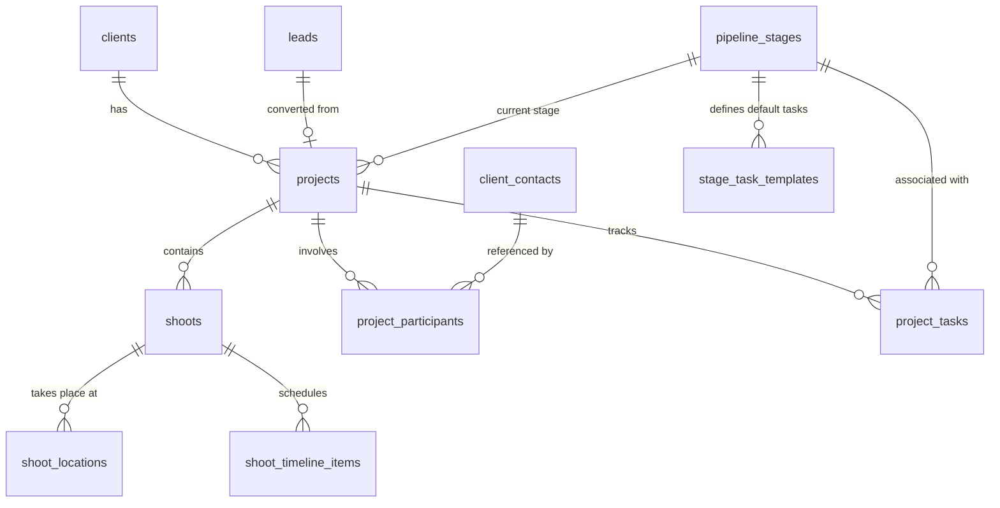

# ADR-0016: Projects and pipeline management (stages, shoot multi-locations, run-of-show, stage tasks, accessible Kanban board, and lead conversion integration)

- Status: Accepted
- Date: 2026-10-14
- Deciders: Maintainer and Architect
- Related ADRs:
  - ADR-0002: Tech stack (Next.js App Router, PostgreSQL, Drizzle ORM, Tailwind CSS, TypeScript)
  - ADR-0003: Self-hosted single studio architecture
  - ADR-0005: Internationalization (en/de catalogues, ICU message formatting)
  - ADR-0007: Audit logging and retention framework
  - ADR-0010: Client search strategy (in-memory substring matching, no search terms in URLs or logs)
  - ADR-0011: Relationship history timeline as a dedicated, typed event table
  - ADR-0012: Data subject rights: export, erasure, and legal holds
  - ADR-0013: Retention runner and esbuild worker loop
  - ADR-0015: Lead capture through public inquiry forms with atomic conversion hook (`registerLeadConversionStep`)

---

## Context

Epic E3 ("Projects / shoots with pipeline stages") forms the core workflow engine for the photographer. According to `projects/ownlight/docs/product/mvp-scope.md` (§E3) and `control/ownlight/roadmap.md`, the platform must provide:

1. **Project types:** Wedding, Portrait, Commercial, Event, Video, etc., with configurable pipeline stages (Default: **Inquiry → Booked → Shot → Editing → Delivered → Archived**).
2. **Shoot details:** Date and time (time-zone aware), multiple locations with addresses and venue notes, day-of timeline / run-of-show schedule items, and participants/roles linked to client contacts.
3. **Views:** Visual Kanban board (drag-and-drop with keyboard alternative) and data table / list view with filtering (stage, type, date, client) and search.
4. **Tasks / checklists per stage:** Stage checklist items to guide project fulfillment.
5. **Lead conversion integration:** Completing the promise from ADR-0015 (D1) where inquiry lead conversion atomically creates both a client and a linked project pre-filled with shoot metadata (`event_type_key`, `event_date`, `event_location`) via `registerLeadConversionStep`.
6. **Cross-cutting compliance:** Full compliance with WCAG 2.2 AA (specifically SC 2.1.1 Keyboard and SC 2.5.7 Dragging Movements), GDPR Art. 5 (data minimisation), Art. 6(1)(b) (contract fulfillment lawful basis), Art. 15/20 (DSAR export), and Art. 17 (erasure with legal hold awareness).

In addition, Epic E3 is the foundational entity for several subsequent epics:

- **E4 (Calendar & Booking):** Shoots and appointments display on the studio calendar and sync via Google Calendar / CalDAV.
- **E5 (Quotes & Proposals):** Quotes and packages attach to a project.
- **E6 (Contracts & E-Signature):** Contracts attach to a project and client.
- **E7 (Questionnaires):** Form submissions (e.g. shot lists, wedding day details) attach to a project.
- **E8 (Email & Workflow Automations):** Automations trigger on project stage transitions and shoot dates.
- **E9 (Client Portal):** Per-project portal accessed via tokenized magic links.
- **E10 (Gallery & Video Delivery):** Photo collections and video deliveries attach to a project.
- **E11 (Agentic CLI & MCP):** Tools for querying, creating, and transitioning projects.
- **E12 (Lexware Office Accounting):** Down-payment and final invoices attach to projects and reconcile payments.

---

## Decision

### 1. Data Model & Database Schema

We define seven relational tables in `src/server/db/schema/projects.ts` (with explicit migrations and synthetic seeds):



#### 1.1 `pipeline_stages`

Defines the sequential stages of the studio pipeline. Seeded with the 6 system default stages from `mvp-scope.md`.

- `id`: UUIDv7 PK.
- `key`: `varchar(32)` unique not null (e.g. `'inquiry'`, `'booked'`, `'shot'`, `'editing'`, `'delivered'`, `'archived'`).
- `name`: `varchar(100)` not null (display name; fallback or system default).
- `position`: `integer` not null unique (1, 2, 3, ... ordering in the pipeline).
- `category`: `varchar(20)` not null (enum: `'inquiry'`, `'booked'`, `'in_progress'`, `'review'`, `'completed'`, `'archived'`).
- `color`: `varchar(32)` not null default `'neutral'` (badge/header colour token).
- `is_system`: `boolean` not null default `true` (system default stages cannot be deleted, but can be renamed).
- `created_at`, `updated_at`: `timestamptz` not null default `now()`.

#### 1.2 `projects`

Core project entity representing a client photography commission.

- `id`: UUIDv7 PK.
- `client_id`: UUID FK → `clients.id` not null (`onDelete: 'cascade'`).
- `stage_id`: UUID FK → `pipeline_stages.id` not null (`onDelete: 'restrict'`).
- `title`: `varchar(200)` not null (e.g. "Emma & Liam Wedding", "Acme Commercial Campaign").
- `project_type_key`: `varchar(40)` not null default `'general'` (e.g. `'wedding'`, `'portrait'`, `'commercial'`, `'event'`, `'video'`).
- `lead_id`: UUID FK → `leads.id` nullable (`onDelete: 'set null'`) — links back to converted lead.
- `primary_shoot_starts_at`: `timestamptz` nullable — denormalized start time of primary shoot for fast indexing, sorting, and calendar queries.
- `primary_shoot_timezone`: `varchar(64)` nullable (e.g. `'Europe/Berlin'`).
- `currency`: `char(3)` not null default `'EUR'`.
- `price_minor`: `bigint` nullable — agreed project total in minor currency units (cents).
- `notes`: `text` nullable — internal photographer notes.
- `last_activity_at`: `timestamptz` not null default `now()`.
- `created_at`, `updated_at`: `timestamptz` not null default `now()`.

_Indexes:_

- `projects_client_id_idx` on `client_id`
- `projects_stage_id_idx` on `stage_id`
- `projects_shoot_starts_at_idx` on `primary_shoot_starts_at`
- `projects_last_activity_at_idx` on `last_activity_at`

#### 1.3 `shoots`

One project can have one or more shoot sessions (e.g. Wedding = Engagement Session + Wedding Day; Commercial = Day 1 Studio + Day 2 On-Location).

- `id`: UUIDv7 PK.
- `project_id`: UUID FK → `projects.id` not null (`onDelete: 'cascade'`).
- `title`: `varchar(200)` not null default `'Shoot'` (e.g. "Main Wedding Day", "Engagement Shoot").
- `starts_at`: `timestamptz` not null (UTC).
- `ends_at`: `timestamptz` nullable (UTC).
- `timezone`: `varchar(64)` not null default `'Europe/Berlin'` (IANA timezone of the physical location, preserving local schedule times regardless of user viewing device).
- `notes`: `text` nullable (e.g. equipment list, lighting gear notes).
- `created_at`, `updated_at`: `timestamptz` not null default `now()`.

#### 1.4 `shoot_locations`

Multiple physical locations per shoot (e.g. Ceremony at Church, Reception at Vineyard).

- `id`: UUIDv7 PK.
- `shoot_id`: UUID FK → `shoots.id` not null (`onDelete: 'cascade'`).
- `name`: `varchar(200)` not null (e.g. "St. Thomas Church", "Villa Berg Grand Hall").
- `address_line1`: `varchar(200)` nullable.
- `address_line2`: `varchar(200)` nullable.
- `postal_code`: `varchar(20)` nullable.
- `city`: `varchar(100)` nullable.
- `country_code`: `char(2)` nullable (ISO 3166-1 alpha-2, e.g. `'DE'`).
- `notes`: `text` nullable (e.g. "Parking around back; priest prohibits flash during vows").
- `order`: `integer` not null default 1.
- `created_at`, `updated_at`: `timestamptz` not null default `now()`.

#### 1.5 `shoot_timeline_items`

Day-of run-of-show schedule items (e.g. "13:00 First Look", "14:30 Ceremony", "18:00 Dinner").

- `id`: UUIDv7 PK.
- `shoot_id`: UUID FK → `shoots.id` not null (`onDelete: 'cascade'`).
- `location_id`: UUID FK → `shoot_locations.id` nullable (`onDelete: 'set null'`).
- `starts_at`: `timestamptz` not null.
- `ends_at`: `timestamptz` nullable.
- `title`: `varchar(200)` not null.
- `description`: `text` nullable.
- `order`: `integer` not null default 1.
- `created_at`, `updated_at`: `timestamptz` not null default `now()`.

#### 1.6 `project_participants`

Associates people and roles with a project. Directly references `client_contacts` for known client contacts, and permits external vendors/collaborators (e.g. "Wedding Planner", "Videographer").

- `id`: UUIDv7 PK.
- `project_id`: UUID FK → `projects.id` not null (`onDelete: 'cascade'`).
- `contact_id`: UUID FK → `client_contacts.id` nullable (`onDelete: 'cascade'`).
- `name`: `varchar(200)` nullable (required if `contact_id` is null).
- `email`: `varchar(255)` nullable.
- `phone`: `varchar(50)` nullable.
- `role`: `varchar(100)` not null (e.g. `'Bride'`, `'Groom'`, `'Planner'`, `'Model'`, `'Art Director'`).
- `is_primary`: `boolean` not null default `false`.
- `notes`: `text` nullable.
- `created_at`, `updated_at`: `timestamptz` not null default `now()`.

_Check constraint:_ `(contact_id IS NOT NULL) OR (name IS NOT NULL AND length(trim(name)) > 0)`.

#### 1.7 `project_tasks` & `stage_task_templates`

- `stage_task_templates`: Defines default checklist tasks per stage (and optional `project_type_key`).
- `project_tasks`: Project-specific task checklist instances.
  - `id`: UUIDv7 PK.
  - `project_id`: UUID FK → `projects.id` not null (`onDelete: 'cascade'`).
  - `stage_id`: UUID FK → `pipeline_stages.id` nullable (`onDelete: 'set null'`).
  - `title`: `varchar(255)` not null.
  - `is_completed`: `boolean` not null default `false`.
  - `completed_at`: `timestamptz` nullable.
  - `due_date`: `timestamptz` nullable.
  - `order`: `integer` not null default 1.
  - `created_at`, `updated_at`: `timestamptz` not null default `now()`.

---

### 2. Pipeline State Machine & Stage Transitions

1. **Pipeline ordering:** Pipeline stages are ordered by `position ASC`.
2. **Flexible transitions:** In professional photography, workflow is rarely strictly linear. Shoots may require additional sessions or rush deliveries. Therefore, transitions between any valid stages are permitted.
3. **Execution service (`transitionProjectStage`):**
   - Executed within a database transaction.
   - Updates `projects.stage_id`, `projects.last_activity_at`, and `projects.updated_at`.
   - Updates `clients.last_activity_at` for the parent client.
   - Emits a timeline event: `project.stage_changed` (`subjectType: 'project'`, `subjectId: project.id`, `data: { from_stage, to_stage }`).
   - Emits an audit log event: `project.stage_changed` (`metadata: { project_id, from_stage, to_stage }`).
   - Serves as the extension point for Epic E8 workflow automations.
4. **Advisory task gating:**
   - Tasks associated with a stage are **advisory**. If incomplete tasks remain when moving to a new stage, the UI presents an accessible confirmation modal summarizing the remaining tasks. The photographer may proceed or cancel. The backend does not hard-block the transition.

---

### 3. Lead Conversion Downstream Hook Integration

In E2 (ADR-0015 §8, TASK-0032), `registerLeadConversionStep` was established to allow E3 to register atomic project creation:

```ts
registerLeadConversionStep({
  id: 'create-project-on-lead-conversion',
  run: async (lead: Lead, clientId: string, tx: DbClient) => { ... }
});
```

**Implementation in E3:**

1. At application startup, E3 registers the conversion step.
2. When `convertLeadToClient` executes (within its single database transaction `tx`):
   - Derives project title: `${lead.givenName} ${lead.familyName} - ${eventTypeLabel}` (fallback: `${client.displayName} - Project`).
   - Sets project type matching `lead.eventTypeKey` (fallback: `'general'`).
   - Assigns the project to the initial pipeline stage (position 1, `'inquiry'`).
   - If `lead.eventDate` is provided, parses the date string and creates a primary `shoots` record with `starts_at` and studio timezone, updating `projects.primary_shoot_starts_at`.
   - If `lead.eventLocation` is provided, creates a `shoot_locations` record linked to the shoot.
   - Fetches the primary contact of the client and links them in `project_participants` with `is_primary = true`.
   - Instantiates default checklist tasks for the initial stage from `stage_task_templates`.
   - Emits `project.created` on the client timeline.
   - Emits `project.created` in the audit log.
3. Because the hook runs inside `convertLeadToClient`'s transaction `tx`, if any step fails, the entire conversion rolls back cleanly.

---

### 4. Kanban Board & List Views (Accessibility & UX Architecture)

#### 4.1 WCAG 2.2 AA Compliance for Kanban Board

Under WCAG 2.2 AA SC 2.1.1 (Keyboard) and SC 2.5.7 (Dragging Movements):

> "All functionality that uses a dragging movement for operation can be achieved by a single pointer without dragging, unless dragging is essential."
> To guarantee 100% compliance without heavy third-party dependencies:

1. **Drag-and-Drop:** Native HTML5 Drag and Drop (`draggable`, `onDragStart`, `onDragOver`, `onDrop`) provides smooth visual dragging between columns for mouse users with zero npm overhead.
2. **Single-Pointer & Keyboard Alternative:** Every card includes an accessible Radix DropdownMenu (`aria-label="Actions for [Project Title]"`) containing:
   - "Move to stage..." submenu listing all available pipeline stages. Selecting a stage immediately moves the project.
   - Direct keyboard trigger: pressing `Enter` on the card action button opens the stage selector.
3. **Screen Reader Announcements:** An `aria-live="polite"` live region announces all movements (e.g., "Project Emma & Liam Wedding moved to Booked stage").
4. **Touch targets:** All interactive buttons and menu items meet the minimum 24×24 px target size with adequate spacing (SC 2.5.8) and standard 44×44 px touch targets for mobile viewport.

#### 4.2 List View & Search Architecture

- **Filtering:** Filters by stage, project type, and date range update URL query parameters (`?stage=booked&type=wedding`), enabling deep linking and bookmarking.
- **Search (ADR-0010 compliance):** Project search queries (searching title, client name, shoot location) are strictly maintained in React state / memory. Search terms are **never** placed into URL query parameters (`?q=`), never logged, and never written to audit metadata, preventing PII leakage into reverse proxy logs or browser history.
- **View toggle:** A toggle button switches between Board and List view, persisted via `localStorage` or URL query parameter (`?view=board` / `?view=list`).

---

### 5. Privacy, DSAR, Retention & Legal Holds

#### 5.1 Personal Data Inventory

- `projects.title`: May contain client names.
- `shoots.notes`: May contain personal schedules or health accommodations (e.g. mobility needs).
- `shoot_locations.address_*` and `notes`: Private residential addresses (e.g. bride's home address) and gate/door codes.
- `shoot_timeline_items.title` and `description`: Personal daily routines.
- `project_participants`: Contact references and external vendor contact details.

#### 5.2 Lawful Basis & Data Minimization

- **Lawful Basis:** GDPR Art. 6(1)(b) (Performance of a contract or pre-contractual steps).
- **Data Minimization:** No personal data is stored in the timeline event `data` column or audit log metadata; events store IDs and stage keys only.

#### 5.3 DSAR Export Integration (`projectsExportProvider`)

Registered with `registerExportProvider`:

- Category: `'projects'`.
- Collects: All projects associated with `clientId` or where `contactId` is a participant.
- Formats: JSON bundle and formatted HTML tables (project title, stage, shoot date, locations, timeline schedule items, participant roles).

#### 5.4 Erasure & Legal Holds Integration

1. **Erasure Provider (`projectsErasureProvider`):**
   - Registered with `registerErasureProvider`.
   - When a client is erased (GDPR Art. 17), cascadingly erases `project_tasks`, `shoot_timeline_items`, `shoot_locations`, `shoots`, `project_participants`, and `projects`.
2. **Erasure Hold Provider (`projectsHoldProvider`):**
   - Registered with `registerErasureHoldProvider`.
   - An active project (stage category is not `'archived'` or `'completed'`, or with a future shoot date) constitutes an active legal obligation / contract fulfillment under GDPR Art. 17(3)(b).
   - If an active project exists for a client, erasure is blocked with `ERASURE_BLOCKED`.
3. **Retention Sweep Activity Provider (`projectsActivityProvider`):**
   - Registered in `src/server/clients/activity.ts` via `registerActivityProvider`.
   - Clients with active projects or recent project activity are marked as active, preventing the automated retention runner from prematurely purging them.

---

### 6. Audit & Timeline Allowlist Registrations

#### 6.1 Audit Metadata Allowlist (`src/server/audit/allowlist.ts`)

```ts
['project.created', ['project_id', 'client_id', 'project_type', 'stage_id', 'lead_id']],
['project.updated', ['project_id', 'changed_fields']],
['project.stage_changed', ['project_id', 'from_stage_id', 'to_stage_id', 'from_stage', 'to_stage']],
['project.deleted', ['project_id', 'client_id']],
['shoot.created', ['shoot_id', 'project_id', 'starts_at']],
['shoot.updated', ['shoot_id', 'project_id', 'changed_fields']],
['shoot.deleted', ['shoot_id', 'project_id']],
['stage_config.updated', ['stage_count', 'changed_stages']],
```

#### 6.2 Timeline Event Registry (`src/server/timeline/registry.ts`)

```ts
{
  type: 'project.created',
  dataKeys: ['project_id', 'project_type'], // Zero PII in data JSONB per §5.2 & ADR-0011 (resolve title at read time if needed)
  messageKey: 'clients.timeline.events.project_created',
},
{
  type: 'project.stage_changed',
  dataKeys: ['project_id', 'from_stage', 'to_stage'],
  messageKey: 'clients.timeline.events.project_stage_changed',
},
{
  type: 'shoot.scheduled',
  dataKeys: ['project_id', 'shoot_id', 'starts_at'],
  messageKey: 'clients.timeline.events.shoot_scheduled',
}
```

---

## Consequences

### Positive

- Fully cohesive project and shoot management system that matches real photography workflows.
- Clean, atomic execution of lead-to-project conversion with zero orphaned records.
- 100% WCAG 2.2 AA compliant Kanban board with native HTML5 drag-and-drop and keyboard/single-pointer alternative.
- Rigorous privacy protection: active project legal holds prevent premature deletion; complete DSAR export and erasure coverage.
- Seamless extension points ready for E4 (Calendar), E5 (Quotes), E6 (Contracts), E8 (Automations), and E9 (Portal).

### Negative / Trade-offs

- Schema spans 7 related tables; migrations must maintain strict foreign key cascades and indexes.
- Advisory task completion requires clear confirmation UX to avoid unintended stage transitions.
