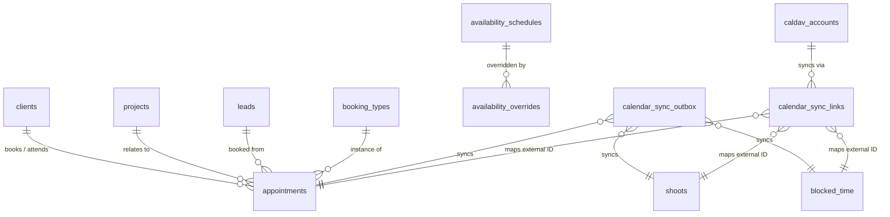

# ADR-0017: Studio Calendar, Availability Engine, Public Booking Scheduler, and External Calendar Sync (Google Calendar, Google Meet, CalDAV, iCal)

- Status: Accepted
- Date: 2026-10-19
- Deciders: Maintainer, Architect
- Related ADRs:
  - ADR-0002: Tech stack (Next.js App Router, PostgreSQL, Drizzle ORM, Tailwind CSS, TypeScript)
  - ADR-0003: Self-hosted single studio architecture
  - ADR-0005: Internationalization (en/de catalogues, ICU message formatting)
  - ADR-0007: Audit logging and structured event framework
  - ADR-0008: Google Workspace integration (Calendar, Meet, OIDC SSO, Contacts)
  - ADR-0010: Search strategy (in-memory filtering, zero PII in query params or logs)
  - ADR-0011: Relationship history timeline as a dedicated, typed event table
  - ADR-0012: Data subject rights: export, erasure, and legal holds
  - ADR-0013: Retention runner and esbuild worker loop
  - ADR-0014: Google OAuth 2.0 integration and encrypted credential vault
  - ADR-0015: Lead capture through public inquiry forms with atomic spam defence
  - ADR-0016: Projects and pipeline management (shoots, locations, run-of-show)

---

## Context

Epic E4 ("Calendar & booking scheduler") delivers the temporal coordination hub for the photography studio. According to `projects/ownlight/docs/product/mvp-scope.md` (§E4) and `control/ownlight/roadmap.md`, the platform must provide:

1. **Studio calendar:** Visual view of shoots (from E3), studio appointments, and blocked personal/studio time in month, week, and day views.
2. **Availability rules & booking types:** Configurable weekly working hours, date-specific overrides, buffer times before/after sessions, minimum advance notice, and session types (e.g., 30-min discovery call, 1-hour consultation, mini-sessions).
3. **Public booking pages:** Client-facing booking scheduler hosted at `/book/[slug]` allowing clients to select dates/times in their detected timezone, complete with first-party spam defence (ALTCHA PoW, honeypot, rate limiting).
4. **Google Calendar & Google Meet sync (opt-in):** Two-way synchronization of shoots and appointments with Google Calendar (`calendar.events` scope per ADR-0008), plus automatic generation of Google Meet video links for consultation calls.
5. **CalDAV sync (opt-in):** Open-protocol two-way sync supporting Apple iCloud, Nextcloud, Fastmail, and other CalDAV servers using encrypted credentials at rest.
6. **iCal feed:** Read-only RFC 5545 `.ics` feed with an instant, revocable secret token for subscription in Apple Calendar, Outlook, and mobile devices.
7. **Explicit timezone management:** Explicit timezone awareness for shoots, appointments, availability rules, and client browser viewports.

Ownlight is a self-hosted, single-studio application. External sync must operate reliably behind NAT, local Docker setups, or Cloudflare tunnels without requiring public static IPs or inbound webhook firewalls. All personal data (client names, phone numbers, notes, and calendar events) must comply strictly with GDPR Art. 5 (data minimisation), Art. 6(1)(b)/(f) (lawful bases), Art. 15/17 (DSAR export and erasure), and OWASP ASVS 5.0 L2 security standards.

---

## Decision

### 1. Data Model & Database Schema

We define nine relational tables in `src/server/db/schema/calendar.ts`:



#### 1.1 `booking_types`

Defines public or internal session types that can be booked via the scheduler.

- `id`: UUIDv7 PK.
- `slug`: `varchar(64)` unique not null (e.g. `'discovery-call'`, `'portrait-consultation'`).
- `title`: `varchar(150)` not null.
- `description`: `text` nullable.
- `duration_minutes`: `integer` not null default 30.
- `buffer_before_minutes`: `integer` not null default 0.
- `buffer_after_minutes`: `integer` not null default 15.
- `min_notice_hours`: `integer` not null default 24 (minimum advance notice to book).
- `max_future_days`: `integer` not null default 60 (how far into future bookings are accepted).
- `location_type`: `varchar(20)` not null default `'google_meet'` (enum: `'in_person'`, `'phone'`, `'google_meet'`).
- `location_details`: `varchar(255)` nullable (e.g. physical address or call instructions).
- `color`: `varchar(32)` not null default `'indigo'`.
- `is_active`: `boolean` not null default `true`.
- `created_at`, `updated_at`: `timestamptz` not null default `now()`.

#### 1.2 `appointments`

Represents scheduled client meetings, consultations, and non-shoot appointments.

- `id`: UUIDv7 PK.
- `booking_type_id`: UUID FK → `booking_types.id` nullable (`onDelete: 'set null'`).
- `client_id`: UUID FK → `clients.id` nullable (`onDelete: 'set null'`).
- `project_id`: UUID FK → `projects.id` nullable (`onDelete: 'set null'`).
- `lead_id`: UUID FK → `leads.id` nullable (`onDelete: 'set null'`).
- `title`: `varchar(200)` not null (e.g. "Consultation: Emma & Liam").
- `status`: `varchar(20)` not null default `'scheduled'` (enum: `'scheduled'`, `'completed'`, `'cancelled'`, `'no_show'`).
- `starts_at`: `timestamptz` not null (UTC).
- `ends_at`: `timestamptz` not null (UTC).
- `timezone`: `varchar(64)` not null default `'Europe/Berlin'` (studio or agreed appointment timezone).
- `attendee_name`: `varchar(200)` not null.
- `attendee_email`: `varchar(255)` not null.
- `attendee_phone`: `varchar(50)` nullable.
- `attendee_notes`: `text` nullable.
- `location_type`: `varchar(20)` not null default `'google_meet'` (enum: `'in_person'`, `'phone'`, `'google_meet'`).
- `location_details`: `varchar(255)` nullable.
- `meet_url`: `varchar(500)` nullable (auto-generated Google Meet video conference link).
- `cancellation_reason`: `text` nullable.
- `cancelled_at`: `timestamptz` nullable.
- `created_at`, `updated_at`: `timestamptz` not null default `now()`.

_Indexes:_

- `appointments_starts_at_idx` on `(starts_at, ends_at)`
- `appointments_client_id_idx` on `client_id`
- `appointments_project_id_idx` on `project_id`
- `appointments_status_idx` on `status`

#### 1.3 `blocked_time`

Studio or personal blackout windows (vacations, dentist, maintenance, travel buffers).

- `id`: UUIDv7 PK.
- `title`: `varchar(200)` not null default `'Blocked Time'`.
- `starts_at`: `timestamptz` not null (UTC).
- `ends_at`: `timestamptz` not null (UTC).
- `all_day`: `boolean` not null default `false`.
- `notes`: `text` nullable.
- `created_at`, `updated_at`: `timestamptz` not null default `now()`.

_Indexes:_

- `blocked_time_starts_at_idx` on `(starts_at, ends_at)`

#### 1.4 `availability_schedules`

Weekly recurring working hours per day of week.

- `id`: UUIDv7 PK.
- `day_of_week`: `integer` not null (0 = Sunday, 1 = Monday, ..., 6 = Saturday).
- `start_time`: `varchar(5)` not null (e.g. `'09:00'`).
- `end_time`: `varchar(5)` not null (e.g. `'17:00'`).
- `is_active`: `boolean` not null default `true`.
- `created_at`, `updated_at`: `timestamptz` not null default `now()`.

#### 1.5 `availability_overrides`

Date-specific schedule modifications (e.g. closed on national holidays or extra Saturday hours).

- `id`: UUIDv7 PK.
- `date`: `varchar(10)` not null (ISO format `'YYYY-MM-DD'`).
- `start_time`: `varchar(5)` nullable (null denotes closed for entire day).
- `end_time`: `varchar(5)` nullable.
- `is_unavailable`: `boolean` not null default `false`.
- `reason`: `varchar(150)` nullable.
- `created_at`, `updated_at`: `timestamptz` not null default `now()`.

_Unique constraint:_ `(date, start_time)`

#### 1.6 `calendar_feeds`

Revocable iCal feed token records.

- `id`: UUIDv7 PK.
- `token_hash`: `varchar(64)` not null unique (SHA-256 hash of secret feed token).
- `name`: `varchar(100)` not null default `'Main Studio Feed'`.
- `summary_level`: `varchar(20)` not null default `'standard'` (enum: `'minimal'`, `'standard'`, `'full'`).
- `is_active`: `boolean` not null default `true`.
- `last_accessed_at`: `timestamptz` nullable.
- `revoked_at`: `timestamptz` nullable.
- `created_at`, `updated_at`: `timestamptz` not null default `now()`.

#### 1.7 `caldav_accounts`

Encrypted CalDAV server connection credentials.

- `id`: UUIDv7 PK.
- `server_url`: `varchar(500)` not null.
- `username`: `varchar(255)` not null.
- `encrypted_password`: `text` not null (AES-256-GCM vault encrypted, purpose `ownlight:vault:caldav`).
- `calendar_home_url`: `varchar(500)` nullable.
- `selected_calendar_url`: `varchar(500)` nullable.
- `selected_calendar_name`: `varchar(255)` nullable.
- `ctag`: `varchar(255)` nullable.
- `sync_token`: `varchar(500)` nullable.
- `is_active`: `boolean` not null default `true`.
- `last_synced_at`: `timestamptz` nullable.
- `last_sync_error`: `text` nullable.
- `created_at`, `updated_at`: `timestamptz` not null default `now()`.

#### 1.8 `calendar_sync_outbox`

Asynchronous outbox queue for outbound calendar synchronization (Google Calendar and CalDAV).

- `id`: UUIDv7 PK.
- `entity_type`: `varchar(20)` not null (enum: `'shoot'`, `'appointment'`, `'blocked_time'`).
- `entity_id`: `uuid` not null.
- `action`: `varchar(20)` not null (enum: `'create'`, `'update'`, `'delete'`).
- `status`: `varchar(20)` not null default `'PENDING'` (enum: `'PENDING'`, `'PROCESSING'`, `'COMPLETED'`, `'FAILED'`).
- `attempts`: `integer` not null default 0.
- `max_attempts`: `integer` not null default 5.
- `next_attempt_at`: `timestamptz` not null default `now()`.
- `last_error`: `text` nullable.
- `created_at`, `updated_at`: `timestamptz` not null default `now()`.

#### 1.9 `calendar_sync_links`

Bidirectional mapping table between Ownlight entities and external calendar provider event IDs.

- `id`: UUIDv7 PK.
- `provider`: `varchar(20)` not null (enum: `'google'`, `'caldav'`).
- `entity_type`: `varchar(20)` not null (enum: `'shoot'`, `'appointment'`, `'blocked_time'`).
- `entity_id`: `uuid` not null.
- `external_event_id`: `varchar(500)` not null.
- `etag`: `varchar(255)` nullable.
- `synced_at`: `timestamptz` not null default `now()`.
- `created_at`, `updated_at`: `timestamptz` not null default `now()`.

_Unique constraint:_ `(provider, entity_type, entity_id)`

---

## 2. Availability Engine & Slot Calculation Algorithm

The availability engine (`src/server/calendar/availability.ts`) calculates open booking slots dynamically:

1. **Input parameters:** `bookingTypeId`, `startDate`, `endDate`, and visitor `timezone`.
2. **Step 1 (Schedule Window):** For each calendar date in range, obtain working hours from `availability_schedules` (by day of week), applying any date-specific overrides from `availability_overrides`.
3. **Step 2 (Candidate Slots):** Generate continuous time slots of length `duration_minutes + buffer_before_minutes + buffer_after_minutes` within active hours.
4. **Step 3 (Internal Subtraction):** Query database for collisions:
   - Existing active `shoots` in range (from `shoots` table, expanding each by `buffer_before_minutes` and `buffer_after_minutes`).
   - Existing active `appointments` in range (where status is `'scheduled'`).
   - Existing `blocked_time` intervals in range.
     Subtract any candidate slot that overlaps with these intervals.
5. **Step 4 (External Busy Subtraction):** If Google Calendar or CalDAV sync is enabled, query external busy periods (cached from periodic inbound sync or queried via `freebusy.query`) and subtract colliding slots.
6. **Step 5 (Lead Time & Past Window Filtering):** Drop slots starting earlier than `now() + min_notice_hours` or further out than `max_future_days`.
7. **Step 6 (Timezone Transformation):** Convert surviving slot `starts_at` and `ends_at` (stored in UTC) into the visitor's requested timezone using standard ECMAScript `Intl.DateTimeFormat`. Return ISO strings and formatted time labels.

---

## 3. Studio Calendar UI Architecture

The internal studio calendar (`/calendar`):

1. **Views:** Month, Week, and Day views.
2. **Unified Event Aggregation:** Server component fetches `shoots` (with parent `projects.title`), `appointments`, and `blocked_time` within the visible date range and renders unified event cards.
3. **Colour Token System:**
   - Shoots: Primary / Indigo token (`bg-indigo-50 border-indigo-200 text-indigo-900 dark:bg-indigo-950 dark:border-indigo-800 dark:text-indigo-200`).
   - Appointments: Amber / Warm token (`bg-amber-50 border-amber-200 text-amber-900 dark:bg-amber-950 dark:border-amber-800 dark:text-amber-200`).
   - Blocked Time: Muted / Slate token (`bg-slate-100 border-slate-300 text-slate-800 dark:bg-slate-800 dark:border-slate-700 dark:text-slate-300`).
4. **Accessibility (WCAG 2.2 AA SC 2.1.1 & SC 1.4.3):**
   - Month view implements an accessible `role="grid"` with arrow key navigation (`ArrowLeft`, `ArrowRight`, `ArrowUp`, `ArrowDown`) moving focus between calendar day cells.
   - Pressing `Enter` on a day cell opens the day detail inspector.
   - Screen readers receive live region announcements on view navigation.
   - All color tokens meet minimum 4.5:1 contrast against event card backgrounds.
5. **Interactive Actions:** Direct creation, editing, and deletion modals for `appointments` and `blocked_time`. Clicking a `shoot` navigates directly to the project detail view (`/projects/[id]`).

---

## 4. Public Booking Pages & Anti-Abuse Architecture

Hosted at `/book/[slug]` (e.g. `/book/discovery-call`):

1. **Zero Client-Side Trackers:** Strictly first-party, no Google Analytics, no external CDNs, no tracking cookies.
2. **Spam & Abuse Defence (E2 Alignment):**
   - ALTCHA Proof-of-Work: Client solves a lightweight WebCrypto SHA-256 challenge before submission using the shared studio HMAC secret (`studioSettings.forms_pow_hmac_key`).
   - Honeypot: Hidden input field `website_url` detected and rejected silently if populated.
   - Rate Limiting: Strict, fail-closed IP rate limiting via `src/server/auth/rate-limiter.ts` (max 5 booking submissions per IP per 15 minutes).
3. **Concurrency Control & Double-Booking Prevention:**
   - Booking creation executes inside a PostgreSQL serializable transaction `tx`.
   - The transaction verifies that the requested slot remains strictly available before executing `INSERT INTO appointments`.
   - If an overlapping appointment, shoot, or blocked time was inserted concurrently, the transaction aborts with a localized, friendly collision message ("This time slot was just booked by another client. Please select another time.").
4. **Downstream Relationship Auto-Association:**
   - Checks if `attendee_email` matches an existing `clients` record. If matched, links `appointment.client_id` and emits `appointment.scheduled` on the client timeline.
   - If no client exists, checks `leads` table. If a lead exists with that email, links `appointment.lead_id`.
   - If neither exists, automatically creates a new `leads` record in state `'inquiry'` with verification badge `'verified'` and source `'booking_scheduler'`, linking `appointment.lead_id`.
5. **Confirmation & Communications:**
   - Displays confirmation screen with date/time in visitor timezone, add-to-calendar `.ics` download link, and Google Meet URL (if applicable).
   - Enqueues booking confirmation email to client and notification email to studio owner via `email_outbox` table (kind: `'appointment_confirmation'`).
   - Enqueues outbound sync task in `calendar_sync_outbox`.

---

## 5. Google Calendar & Google Meet Integration

1. **OAuth Scope Expansion & Incremental Consent:**
   - Extends Google OAuth integration (ADR-0008, ADR-0014) by adding scope `https://www.googleapis.com/auth/calendar.events`.
   - Supports incremental consent (`include_granted_scopes: true`): existing users who connected Google Contacts in E1 can enable Calendar in `/settings/integrations/google` without disconnecting or losing contacts tokens.
2. **Google Meet Auto-Generation:**
   - When creating an appointment with `location_type === 'google_meet'`, the outbound sync worker requests a Google Meet conference link via Google Calendar API:
     ```json
     {
       "conferenceData": {
         "createRequest": {
           "requestId": "<uuid>",
           "conferenceSolutionKey": { "type": "hangoutsMeet" }
         }
       }
     }
     ```
     with query parameter `conferenceDataVersion=1`.
   - The returned `hangoutLink` is saved to `appointments.meet_url`.
3. **Outbound Sync:**
   - Studio shoots, appointments, and blocked times are pushed to the photographer's selected Google Calendar.
   - PII minimization: Google Calendar event titles format as `[Studio Name] - [Type]: [First Name] [Last Initial]` (e.g. "Ownlight - Consultation: Emma L."). Private shoot notes, addresses, and full contact details are kept within Ownlight unless explicitly enabled by photographer.
4. **Inbound Busy Period Sync:**
   - Background worker job (`calendar-sync-worker`) queries Google Calendar free/busy API (`freebusy.query`) periodically (every 10 minutes) for a rolling window of `[-1 day, +60 days]`, storing busy intervals in memory / cache to prevent public double-booking.

---

## 6. CalDAV Integration (Apple iCloud, Nextcloud, Fastmail)

1. **Protocol & Library Selection:**
   - Standard RFC 4791 / RFC 4918 CalDAV client using `tsdav` (MIT-licensed, developed by Cal.com, zero Node-only globals, native TypeScript).
2. **Credential Vault Security:**
   - CalDAV server URL, username, and app-specific password stored encrypted at rest via `src/server/crypto/vault.ts` with dedicated HKDF subkey purpose `ownlight:vault:caldav`.
3. **Calendar Discovery & Selection:**
   - Connect wizard in `/settings/integrations/caldav` validates credentials, performs discovery on `calendar-home-set`, lists available user calendars (e.g., "Personal", "Work"), and allows the owner to choose which calendar to sync.
4. **Two-Way Synchronization:**
   - Outbound: Creates/updates/deletes `VEVENT` objects via HTTP `PUT` / `DELETE` through `calendar_sync_outbox`.
   - Inbound: Queries `REPORT calendar-query` to import busy intervals and external events.

---

## 7. Revocable iCal Feed Subscription

1. **Endpoint Architecture:**
   - Route handler at `/api/calendar/feed/[token].ics`.
   - High-entropy secret token (32 cryptographically secure random bytes, base64url encoded).
   - Stored in `calendar_feeds.token_hash` as `SHA-256(token)`. Plaintext token is only displayed once upon generation.
2. **RFC 5545 Generation:**
   - Zero-dependency, lightweight, type-safe VCALENDAR / VEVENT generator (`src/server/calendar/ical.ts`).
   - Implements strict CRLF line endings (`\r\n`), line folding at 75 octets, and text escaping (`\\`, `\,`, `\;`, `\n`).
   - Content-Type: `text/calendar; charset=utf-8`.
   - Cache-Control: `private, no-cache, no-store, max-age=0, must-revalidate`.
3. **Revocation & Rotation:**
   - Settings UI allows the photographer to click "Regenerate Feed URL".
   - Immediately sets `calendar_feeds.revoked_at = now()`, rendering the old URL instantly inert (returns HTTP 404/401).

---

## 8. Privacy, DSAR, Retention & Audit Trails

1. **Personal Data Inventory:**
   - `appointments.attendee_name`, `attendee_email`, `attendee_phone`, `attendee_notes`.
   - `caldav_accounts.username`, `encrypted_password`.
2. **Lawful Basis:**
   - GDPR Art. 6(1)(b) (performance of a contract or taking steps prior to entering into a contract).
   - GDPR Art. 6(1)(f) (legitimate interest for calendar synchronization and mobile caller/schedule awareness).
3. **DSAR Export (`appointmentsExportProvider`):**
   - Registered with `registerExportProvider` (`src/server/privacy/export-registry.ts`).
   - Exports all appointments linked to the subject's `clientId`, `contactId`, or `attendee_email` as structured JSON and formatted HTML.
4. **Erasure (`appointmentsErasureProvider`):**
   - Registered with `registerErasureProvider` (`src/server/privacy/erasure-registry.ts`).
   - When a client or lead is erased under GDPR Art. 17:
     - For past/completed appointments: Anonymizes attendee name, email, phone, and notes (setting `attendee_name = 'Erased Client'`, `attendee_email = 'erased@redacted.local'`).
     - For upcoming scheduled appointments: Deletes the appointment and cancels linked calendar sync entries.
5. **Audit Metadata Allowlist Registrations (`src/server/audit/allowlist.ts`):**
   - `booking_type.created`: `['booking_type_id', 'slug', 'duration_minutes']`
   - `booking_type.updated`: `['booking_type_id', 'changed_fields']`
   - `booking_type.deleted`: `['booking_type_id']`
   - `appointment.created`: `['appointment_id', 'booking_type_id', 'starts_at', 'location_type', 'client_id', 'lead_id']`
   - `appointment.updated`: `['appointment_id', 'changed_fields']`
   - `appointment.cancelled`: `['appointment_id', 'reason']`
   - `blocked_time.created`: `['blocked_time_id', 'starts_at', 'ends_at', 'all_day']`
   - `blocked_time.updated`: `['blocked_time_id', 'changed_fields']`
   - `blocked_time.deleted`: `['blocked_time_id']`
   - `availability.updated`: `['schedule_count', 'override_count']`
   - `calendar_feed.created`: `['feed_id', 'summary_level']`
   - `calendar_feed.revoked`: `['feed_id']`
   - `integration.caldav.connected`: `['account_id', 'server_url', 'calendar_name']`
   - `integration.caldav.disconnected`: `['account_id']`
   - `calendar_sync.executed`: `['provider', 'synced_count', 'failed_count', 'duration_ms']`
6. **Timeline Event Registry (`src/server/timeline/registry.ts`):**
   - `appointment.scheduled`: `dataKeys: ['appointment_id', 'starts_at', 'location_type']`, messageKey: `clients.timeline.events.appointment_scheduled`.
   - `appointment.cancelled`: `dataKeys: ['appointment_id', 'reason']`, messageKey: `clients.timeline.events.appointment_cancelled`.

---

## Alternatives Considered

1. **Single Polymorphic Calendar Events Table:**
   - _Rejected:_ Merging shoots, appointments, and blocked time into a single polymorphic table violates clean normalization. Shoots (E3) possess complex relations (multiple locations, run-of-show timeline items, participant roles, pipeline stage link), whereas blocked time is simply a start/end interval. Separate relational tables with a unified query abstraction provide strong type safety and zero migration risk for E3.
2. **Inbound Webhook Push for Google & CalDAV:**
   - _Rejected:_ Webhooks require a publicly accessible domain, SSL validation, and open inbound firewall ports. For self-hosted instances running in Docker, behind home NATs, or via private tunnels, webhooks fail. Decoupled outbox push plus periodic background worker polling guarantees 100% reliability in every deployment environment.
3. **Full CalDAV Client Handcrafted from Scratch:**
   - _Rejected:_ CalDAV (RFC 4791) has substantial XML WebDAV complexity (multistatus responses, sync tokens, timezone quirks in Apple iCloud). Using `tsdav` (MIT licensed, created by Cal.com) delivers a battle-tested, portable, TypeScript-native solution with zero supply-chain friction.
4. **Unredacted iCal Feed:**
   - _Rejected:_ Serving unredacted client phone numbers, addresses, and internal notes in an `.ics` subscription feed risks leaking client PII across unsecured corporate calendar syncing. Defaulting to standard summary with sanitized attendee initials upholds GDPR Art. 25 (privacy by default).

---

## Consequences

### Positive

- Unified studio calendar seamlessly connects shoots, consultations, and blocked time in one responsive interface.
- Complete self-hosted booking scheduler eliminates reliance on third-party SaaS (Calendly, Acuity) with zero external script tracking.
- Opt-in, least-privilege two-way sync with both proprietary (Google Calendar & Meet) and open-standard (CalDAV, iCal) calendar ecosystems.
- Robust anti-abuse protection using first-party ALTCHA PoW and fail-closed rate limiting.
- Full privacy compliance with DSAR export, anonymization on erasure, and zero PII leakage in audit logs.

### Negative / Trade-offs

- Introducing CalDAV and iCal adds schema entities and sync state management across providers.
- External sync conflict resolution requires careful outbox retry mechanics and etag validation.

---

## Security & Privacy Impact

- **OWASP ASVS 5.0 V10 (OAuth & OIDC) & V11 (Cryptography):** AES-256-GCM vault encryption for CalDAV passwords and Google tokens with HKDF subkeys; session-bound PKCE state; high-entropy SHA-256 feed tokens.
- **GDPR Art. 5, 25 (Data Minimisation & Privacy by Default):** Minimized calendar feed payloads; zero third-party client trackers; strictly opt-in external sync.
- **GDPR Art. 15 & 17:** Complete DSAR export coverage and automated anonymization/deletion upon subject erasure.
- **WCAG 2.2 AA:** Accessible calendar grid navigation (SC 2.1.1 Keyboard), visible focus indicators, and 4.5:1 color contrast.
