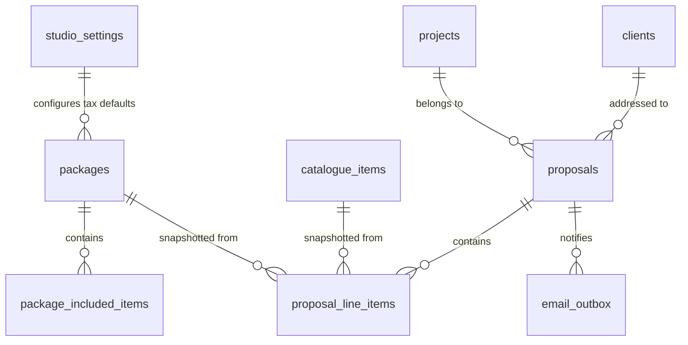

# ADR-0018: Packages, product catalogue, quotes, and interactive client proposals with snapshot immutability and statutory retention

- Status: Accepted (2026-10-27)
- Date: 2026-10-27
- Deciders: Maintainer, Architect
- Related ADRs:
  - ADR-0002: Tech stack (Next.js App Router, PostgreSQL, Drizzle ORM, Tailwind CSS, TypeScript)
  - ADR-0003: Self-hosted single studio architecture
  - ADR-0005: Internationalization (en/de catalogues, ICU message formatting)
  - ADR-0007: External accounting & tax platform connector (Lexware Office)
  - ADR-0010: Client search strategy (in-memory filtering, zero PII in query params or logs)
  - ADR-0011: Relationship history timeline as a dedicated, typed event table
  - ADR-0012: Data subject rights: export, erasure, and legal holds
  - ADR-0013: Retention runner and esbuild worker loop
  - ADR-0015: Lead capture through public inquiry forms with atomic spam defence
  - ADR-0016: Projects and pipeline management (stages, shoots, lead conversion step)
  - ADR-0017: Studio calendar, availability engine, and public booking scheduler

---

## Context

Epic E5 ("Packages, quotes & proposals") delivers commercial cataloguing, quote generation, and interactive proposal acceptance for the photography studio. According to `projects/ownlight/docs/product/mvp-scope.md` (§E5) and `control/ownlight/roadmap.md`, the platform must provide:

1. **Package & product catalogue:** Structured base packages (e.g. "Full Day Wedding Coverage", "Portrait Session Standard") with included deliverables, plus add-on products and services (e.g. "Additional Hour", "Second Photographer", "Handcrafted Leather Album", "Drone Footage").
2. **Tax & pricing rules:** Accurate monetary representation in integer minor currency units (cents), tax rate attribution in basis points (hundredths of a percent, e.g. 1900 for 19.00%, 700 for 7.00%), support for Gross vs. Net pricing display modes, and statutory compliance with the German Small Business Exemption (_Kleinunternehmerregelung_ per §19 UStG) including mandatory invoice/quote legal notices.
3. **Quotes & interactive proposals:** Proposals built from catalogue packages with client-selectable optional add-ons and quantity selectors, validity expiration dates, and real-time total recalculation in the browser.
4. **Snapshot immutability:** Once a quote or proposal is sent to a client or accepted, historical line items, descriptions, and prices must be permanently frozen in an immutable snapshot so subsequent edits to studio packages or catalogue prices never retroactively mutate historical proposals.
5. **Public tokenised client view & acceptance ceremony:** Frictionless, secure client access via a revocable secret token URL (`/p/[token]`) prior to the full client portal in E9, protected against brute-force attacks by rate limiting and SHA-256 database token hashing, culminating in an authenticated acceptance ceremony recording timestamp, client confirmation details, and an anonymised IP trail.
6. **Downstream interfaces:**
   - **E6 Contracts & e-signature:** Accepted proposal package, options, and total price flow directly into contract merge fields (`{{package.name}}`, `{{package.total}}`, `{{package.items}}`).
   - **E9 Client portal:** Interactive proposal pages conform to future portal route hierarchies and authentication contracts.
   - **E12 Lexware Office accounting connector:** Proposal line items with precise minor unit prices and VAT classifications pass directly to Lexware Office REST API v1 for automatic down-payment (_Anzahlungsrechnung_) and final invoice creation (ADR-0007).
7. **Compliance & data protection:** Comprehensive GDPR Art. 15 DSAR export coverage, GDPR Art. 17 erasure with statutory retention locks (_Aufbewahrungspflichten_ under §147 AO / §257 HGB / §195 BGB for accepted commercial agreements), client relationship timeline integration (ADR-0011), and audit logging (ADR-0007).

---

## Decision

### 1. Data Model & Database Schema

We define five relational tables in `src/server/db/schema/packages.ts` and `src/server/db/schema/proposals.ts`, and augment `studio_settings`:



#### 1.1 Studio Settings Tax Fields (`studio_settings` additions)

We augment `studio_settings` (`src/server/db/schema/studio-settings.ts`) with studio-wide tax and pricing configuration:

- `tax_number`: `varchar(50)` nullable — German tax number (_Steuernummer_).
- `vat_id`: `varchar(50)` nullable — EU VAT Identification Number (_USt-IdNr._, e.g. `DE123456789`).
- `is_kleinunternehmer`: `boolean` not null default `false` — §19 UStG small business status.
- `kleinunternehmer_notice`: `text` nullable — statutory notice text (defaults to localized standard text in German: _"Gemäß § 19 UStG wird keine Umsatzsteuer berechnet."_ / English: _"According to § 19 UStG, no value added tax is charged."_).
- `default_tax_rate_basis_points`: `integer` not null default 1900 — default VAT rate in basis points (1900 = 19.00%, 700 = 7.00%, 0 = 0.00%).
- `prices_include_tax`: `boolean` not null default `true` — Gross pricing (B2C consumer default, prices displayed inclusive of VAT) vs. Net pricing (B2B commercial default, prices displayed exclusive of VAT with tax added on top).

#### 1.2 `packages`

Represents structured photography service packages offered by the studio:

- `id`: UUIDv7 PK.
- `name`: `varchar(150)` not null (e.g. "Full Day Wedding Coverage", "Portrait Session Standard").
- `slug`: `varchar(100)` unique not null.
- `description`: `text` nullable — studio-authored rich description or scope overview.
- `project_type_key`: `varchar(40)` nullable — optional link to project types (`'wedding'`, `'portrait'`, `'commercial'`, `'event'`, `'video'`) to filter packages in the proposal builder; `null` indicates availability across all project types.
- `base_price_minor`: `bigint` not null default 0 — base price in integer minor units (e.g. `250000` for €2,500.00).
- `currency`: `char(3)` not null default `'EUR'`.
- `tax_rate_basis_points`: `integer` not null default 1900 — VAT rate in basis points (e.g. 1900 = 19.00%, 700 = 7.00% for artistic licensing, 0 = 0%).
- `position`: `integer` not null default 0 — display ordering index.
- `is_active`: `boolean` not null default `true` — soft deactivation so historical packages remain intact.
- `created_at`, `updated_at`: `timestamptz` not null default `now()`.

#### 1.3 `package_included_items`

Defines deliverables and features bundled into a base package:

- `id`: UUIDv7 PK.
- `package_id`: UUID FK → `packages.id` not null (`onDelete: 'cascade'`).
- `title`: `varchar(200)` not null (e.g. "8 Hours of Continuous Coverage", "400+ High-Resolution Edited Images", "Private Online Gallery").
- `description`: `text` nullable.
- `quantity`: `integer` not null default 1.
- `position`: `integer` not null default 0.
- `created_at`, `updated_at`: `timestamptz` not null default `now()`.

#### 1.4 `catalogue_items`

Represents reusable standalone products, add-on services, and equipment rentals available across proposals:

- `id`: UUIDv7 PK.
- `name`: `varchar(150)` not null (e.g. "Additional Coverage Hour", "Second Photographer", "Fine Art Leather Album 30x30", "Drone Aerial Photography").
- `slug`: `varchar(100)` unique not null.
- `description`: `text` nullable.
- `category`: `varchar(32)` not null default `'service'` — enum: `'service'`, `'product'`, `'travel'`, `'licensing'`.
- `unit_price_minor`: `bigint` not null default 0 — unit price in minor units.
- `currency`: `char(3)` not null default `'EUR'`.
- `tax_rate_basis_points`: `integer` not null default 1900.
- `position`: `integer` not null default 0.
- `is_active`: `boolean` not null default `true`.
- `created_at`, `updated_at`: `timestamptz` not null default `now()`.

#### 1.5 `proposals`

Core commercial proposal entity attached to a client commission:

- `id`: UUIDv7 PK.
- `project_id`: UUID FK → `projects.id` not null (`onDelete: 'cascade'`).
- `client_id`: UUID FK → `clients.id` not null (`onDelete: 'restrict'`).
- `title`: `varchar(200)` not null (e.g. "Photography Proposal — Emma & Liam Wedding").
- `status`: `varchar(20)` not null default `'draft'` — enum: `'draft'`, `'sent'`, `'accepted'`, `'declined'`, `'expired'`, `'superseded'`.
- `version`: `integer` not null default 1 — revision counter.
- `currency`: `char(3)` not null default `'EUR'`.
- `subtotal_minor`: `bigint` not null default 0 — sum of selected items before tax (net or gross depending on pricing mode).
- `tax_minor`: `bigint` not null default 0 — total calculated tax amount in minor units.
- `total_minor`: `bigint` not null default 0 — total payable amount in minor units.
- `prices_include_tax`: `boolean` not null default `true` — snapshotted from studio settings at creation time.
- `is_kleinunternehmer`: `boolean` not null default `false` — snapshotted from studio settings at creation time.
- `tax_notice`: `text` nullable — snapshotted statutory tax note.
- `valid_until`: `timestamptz` nullable — expiration date/time.
- `token_hash`: `varchar(64)` not null unique — SHA-256 hash of revocable public secret token.
- `token_revoked_at`: `timestamptz` nullable.
- `sent_at`: `timestamptz` nullable.
- `accepted_at`: `timestamptz` nullable.
- `declined_at`: `timestamptz` nullable.
- `decline_reason`: `text` nullable.
- `accepted_by_name`: `varchar(200)` nullable.
- `accepted_by_email`: `varchar(255)` nullable.
- `acceptance_ip_anonymized`: `varchar(64)` nullable — IPv4 masked to `/24`, IPv6 masked to `/48`.
- `acceptance_user_agent`: `varchar(255)` nullable — truncated browser user-agent string.
- `accepted_options_snapshot`: `jsonb` nullable — complete, immutable JSON snapshot of all line items, quantities, and monetary totals at the exact second of acceptance.
- `internal_notes`: `text` nullable — private photographer notes.
- `created_at`, `updated_at`: `timestamptz` not null default `now()`.

_Indexes:_

- `proposals_project_id_idx` on `(project_id)`
- `proposals_client_id_idx` on `(client_id)`
- `proposals_token_hash_idx` on `(token_hash)`
- `proposals_status_idx` on `(status)`

#### 1.6 `proposal_line_items`

Individual line items belonging to a proposal:

- `id`: UUIDv7 PK.
- `proposal_id`: UUID FK → `proposals.id` not null (`onDelete: 'cascade'`).
- `package_id`: UUID FK → `packages.id` nullable (`onDelete: 'set null'`) — optional back-reference.
- `catalogue_item_id`: UUID FK → `catalogue_items.id` nullable (`onDelete: 'set null'`) — optional back-reference.
- `item_type`: `varchar(20)` not null default `'addon'` — enum: `'base_package'`, `'addon'`, `'custom'`.
- `name`: `varchar(200)` not null — snapshotted item name.
- `description`: `text` nullable — snapshotted item description.
- `unit_price_minor`: `bigint` not null default 0 — snapshotted unit price.
- `quantity`: `integer` not null default 1.
- `min_quantity`: `integer` not null default 0.
- `max_quantity`: `integer` not null default 1.
- `tax_rate_basis_points`: `integer` not null default 1900 — snapshotted VAT rate in basis points.
- `is_optional`: `boolean` not null default `false` — `false` for base packages or mandatory items; `true` for client-selectable add-ons.
- `is_selected`: `boolean` not null default `true` — current selection state.
- `position`: `integer` not null default 0.
- `created_at`, `updated_at`: `timestamptz` not null default `now()`.

_Indexes:_

- `proposal_line_items_proposal_id_idx` on `(proposal_id, position)`

---

### 2. Snapshot Immutability & Mathematical Calculation Engine

#### 2.1 Immutability by Design

1. **At Proposal Composition:** When the photographer selects a base package or catalogue add-on, `proposal_line_items` stores a full duplicate copy of `name`, `description`, `unit_price_minor`, and `tax_rate_basis_points`. Foreign keys to `packages` and `catalogue_items` use `onDelete: 'set null'`. Future catalogue updates or deletions never alter existing proposals.
2. **At Proposal Dispatch (`status: 'sent'`):** Proposal prices and items are locked against casual client tampering. The photographer can revise an unaccepted proposal, which increments `version` and re-validates item constraints.
3. **At Proposal Acceptance (`status: 'accepted'`):**
   - The selected items, unit prices, applied quantities, subtotal, tax breakdown, and total are serialized into `accepted_options_snapshot` (`jsonb`).
   - The proposal state transitions to `'accepted'`.
   - The database and domain service reject any further updates to `proposals` or `proposal_line_items`.
   - If the client subsequently requests changes, the photographer must create a new revision proposal which supersedes the accepted one (`status: 'superseded'`).

#### 2.2 Integer Minor Units & Basis Points Calculation Engine

To eliminate IEEE-754 floating point precision drift, all monetary and tax calculations execute strictly in 64-bit integer arithmetic:

```typescript
export interface TaxCalculationResult {
  subtotalMinor: number;
  taxMinor: number;
  totalMinor: number;
  breakdown: Array<{
    taxRateBasisPoints: number;
    taxRatePercentFormatted: string;
    netMinor: number;
    taxMinor: number;
    grossMinor: number;
  }>;
}

export function calculateProposalTotals(
  items: Array<{
    unitPriceMinor: number;
    quantity: number;
    taxRateBasisPoints: number;
    isSelected: boolean;
  }>,
  options: {
    pricesIncludeTax: boolean;
    isKleinunternehmer: boolean;
  },
): TaxCalculationResult {
  const selectedItems = items.filter((i) => i.isSelected && i.quantity > 0);

  if (options.isKleinunternehmer) {
    const totalMinor = selectedItems.reduce(
      (sum, item) => sum + item.unitPriceMinor * item.quantity,
      0,
    );
    return {
      subtotalMinor: totalMinor,
      taxMinor: 0,
      totalMinor,
      breakdown: [],
    };
  }

  // Aggregate by tax rate basis points
  const rateBuckets = new Map<number, number>();
  for (const item of selectedItems) {
    const itemTotal = item.unitPriceMinor * item.quantity;
    rateBuckets.set(
      item.taxRateBasisPoints,
      (rateBuckets.get(item.taxRateBasisPoints) ?? 0) + itemTotal,
    );
  }

  let calculatedSubtotal = 0;
  let calculatedTax = 0;
  let calculatedTotal = 0;
  const breakdown: TaxCalculationResult['breakdown'] = [];

  for (const [rateBasisPoints, amountMinor] of rateBuckets.entries()) {
    let net = 0;
    let tax = 0;
    let gross = 0;

    if (options.pricesIncludeTax) {
      // Amount is Gross: Net = Gross / (1 + Rate)
      gross = amountMinor;
      net = Math.round((gross * 10000) / (10000 + rateBasisPoints));
      tax = gross - net;
    } else {
      // Amount is Net: Tax = Net * Rate
      net = amountMinor;
      tax = Math.round((net * rateBasisPoints) / 10000);
      gross = net + tax;
    }

    calculatedSubtotal += options.pricesIncludeTax ? gross : net;
    calculatedTax += tax;
    calculatedTotal += gross;

    breakdown.push({
      taxRateBasisPoints: rateBasisPoints,
      taxRatePercentFormatted: (rateBasisPoints / 100).toFixed(2),
      netMinor: net,
      taxMinor: tax,
      grossMinor: gross,
    });
  }

  return {
    subtotalMinor: calculatedSubtotal,
    taxMinor: calculatedTax,
    totalMinor: calculatedTotal,
    breakdown,
  };
}
```

---

### 3. Public Interactive Client Proposal View & Acceptance Ceremony (`/p/[token]`)

#### 3.1 Token Security & Cookieless Route

- **Token Generation:** 32-byte cryptographically secure random token (`crypto.randomBytes(32).toString('base64url')`).
- **Storage:** Only `token_hash = sha256(token)` is stored in PostgreSQL. Raw tokens are never logged or stored.
- **Revocation:** Photographers can click _"Revoke & Generate New Link"_ at any time, which sets `token_revoked_at = now()` and generates a fresh token hash.
- **Cookieless Route:** In `src/middleware.ts`, `/p/[token]` and `/[locale]/p/[token]` are added to `PUBLIC_PATH_SEGMENTS`. All session cookies are stripped on response (`response.headers.delete('set-cookie')`) per TDDDG §25 and GDPR Art. 5.
- **Anti-Abuse & Rate Limiting:** Protected by fail-closed atomic rate limiting (30 requests/minute per IP) using `rate-limiter.ts`.

#### 3.2 Interactive Selection & Total Recalculation

- The public proposal page displays the photographer's branding, proposal title, validity date, base package deliverables, and optional add-on products.
- Clients can toggle optional add-ons or increase allowed quantities (between `min_quantity` and `max_quantity`).
- Totals update reactively in the browser using the shared `calculateProposalTotals` logic and `formatCurrency`.
- If `valid_until < now()`, the view renders a clear "Proposal Expired" banner and disables all interactive selection controls.

#### 3.3 Acceptance Ceremony

When the client clicks "Accept Proposal":

1. A confirmation modal prompts for:
   - Full Name (required, pre-filled from client contact if available).
   - Email Address (required, pre-filled).
   - Mandatory acceptance checkbox (_"I accept this proposal, the deliverables described, and the total amount of €X.XX"_).
2. The client submits the server action `acceptProposalAction({ token, selectedOptionIds, acceptedByName, acceptedByEmail })`.
3. The server action executes inside a PostgreSQL serializable transaction:
   - Resolves the proposal by `sha256(token)`.
   - Validates that `status === 'sent'` (or `'draft'` in studio preview mode), `token_revoked_at` is null, and `valid_until` has not passed.
   - Verifies that all `selectedOptionIds` belong to the proposal and base packages cannot be deselected.
   - Recalculates exact minor unit totals on the server.
   - Freezes `accepted_options_snapshot` (`jsonb`) containing line item IDs, names, unit prices, quantities, and totals.
   - Anonymizes the client's IP address (IPv4 `/24`, IPv6 `/48`) and captures truncated `User-Agent`.
   - Transitions `proposals.status = 'accepted'` and sets `accepted_at = now()`.
   - Updates `projects.price_minor = proposal.total_minor` and `projects.currency = proposal.currency`.
   - If the project is currently in stage `'inquiry'`, automatically advances the project stage to `'booked'` (configurable).
   - Records client relationship timeline event `proposal.accepted`.
   - Records audit log event `proposal.accepted`.
   - Enqueues client confirmation and studio owner notification emails in `email_outbox`.

---

### 4. Downstream Subsystem Interfaces

#### 4.1 Interface to E6 (Contracts & E-Signature)

Accepted proposals serve as the primary commercial basis for contract generation:

```typescript
export interface AcceptedProposalSummary {
  proposalId: string;
  projectId: string;
  packageName: string;
  includedItems: string[];
  selectedAddons: Array<{ name: string; quantity: number; unitPriceMinor: number }>;
  subtotalMinor: number;
  taxMinor: number;
  totalMinor: number;
  currency: string;
  acceptedAt: Date;
  acceptedByName: string;
  acceptedByEmail: string;
}

export async function getAcceptedProposalForProject(
  projectId: string,
  tx?: DbClient,
): Promise<AcceptedProposalSummary | null>;
```

E6 contract templates inject these fields directly into contract merge tags: `{{package.name}}`, `{{package.total}}`, `{{package.items}}`, `{{proposal.accepted_date}}`.

#### 4.2 Interface to E9 (Client Portal)

The tokenised route `/p/[token]` is designed for forwards-compatibility with E9:

- When E9 launches, the client portal at `/portal/[token]` will link directly to `/p/[token]` or render the proposal component inline.
- The shared design system primitives (`Card`, `Badge`, `Button`, `Dialog`) and responsive layouts ensure visual consistency.

#### 4.3 Interface to E12 (Lexware Office Accounting Connector)

Per ADR-0007, down-payment invoices (_Anzahlungsrechnungen_) and final invoices generated in Lexware require exact line item pricing and tax attribution:

- Each item in `proposal_line_items` preserves `name`, `unit_price_minor`, `quantity`, and `tax_rate_basis_points`.
- The Lexware connector maps proposal items directly to Lexware API line item payloads:
  ```json
  {
    "type": "custom",
    "name": "Full Day Wedding Coverage",
    "quantity": 1,
    "unitName": "Pauschale",
    "unitPrice": { "currency": "EUR", "netAmount": 2100.84, "taxRatePercentage": 19 },
    "discountPercentage": 0
  }
  ```
- If `is_kleinunternehmer === true`, E12 sets `taxRatePercentage: 0` and appends the statutory notice to the invoice footer.

---

### 5. Transactional Email Outbox Notifications

We extend `src/server/db/schema/email-outbox.ts`:

- Add `proposal_id`: UUID FK → `proposals.id` nullable (`onDelete: 'cascade'`).
- Extend `EMAIL_OUTBOX_KINDS` and check constraint:
  ```sql
  CHECK (kind IN (
    'lead_auto_reply',
    'appointment_confirmation',
    'appointment_cancellation',
    'proposal_sent',
    'proposal_accepted_client',
    'proposal_accepted_owner'
  ))
  ```

1. **`proposal_sent`:** Sent to client contact email with link to `/p/[token]`, proposal title, studio name, validity date, and total amount.
2. **`proposal_accepted_client`:** Sent to client upon acceptance confirming selected package, add-ons, total price, and next steps (e.g. contract review).
3. **`proposal_accepted_owner`:** Sent to studio owner alerting them that the proposal was accepted, linking to `/projects/[id]`.

All emails adhere to ADR-0015 §7: zero copied personal data in outbox rows, RFC 3834 anti-loop headers, and plain-text fallback parts.

---

### 6. Privacy, Security & Compliance

#### 6.1 GDPR Art. 15 DSAR Export Provider

We register `proposalsExportProvider` via `registerExportProvider` in `src/server/privacy/export-registry.ts`:

- Subject kinds: `client`, `contact`.
- JSON export category: `proposals` with schema `ownlight.dsar.v1`.
- HTML export: Localized, accessible table (en/de) listing Proposal Title, Status, Sent Date, Accepted Date, Accepted By, Line Items, and Total Amount.

#### 6.2 GDPR Art. 17 Erasure & Statutory Retention Locks

We establish distinct lifecycle rules for pre-contractual vs. accepted commercial records:

1. **Unaccepted / Draft / Declined Proposals:** Represent pre-contractual discussions. When a client requests erasure, `proposalsErasureProvider` hard-deletes unaccepted proposals and their line items.
2. **Accepted Commercial Proposals on Projects:** Under German commercial and tax law (§147 Abs. 1 Nr. 2 AO, §257 Abs. 1 Nr. 2 HGB), commercial business letters and agreements forming the basis of bookings and invoices are subject to mandatory statutory retention (6 to 10 years).
   - We register `proposalsHoldProvider` via `registerErasureHoldProvider`: If an accepted proposal exists on a project, client erasure is blocked with reason `statutory.commercial_document` and a retention lock date calculated from statutory rules (or until project archiving + statutory retention expiration).
3. **Retention Policy:** The automated retention sweep (`retention-runner`) prunes unaccepted, expired, or declined proposals older than 12 months (configurable) where no project was booked.

#### 6.3 Audit Allowlist & Timeline Registry

- **Audit Allowlist (`src/server/audit/allowlist.ts`):**
  - `package.created`, `package.updated`, `package.deleted`
  - `catalogue_item.created`, `catalogue_item.updated`, `catalogue_item.deleted`
  - `proposal.created`, `proposal.updated`, `proposal.sent`, `proposal.accepted`, `proposal.declined`, `proposal.revoked`
- **Timeline Registry (`src/server/timeline/registry.ts`):**
  - `proposal.sent` — `dataKeys: ['proposal_id', 'total_minor', 'currency']`
  - `proposal.accepted` — `dataKeys: ['proposal_id', 'total_minor', 'currency']`
  - `proposal.declined` — `dataKeys: ['proposal_id']`

---

## Alternatives Considered

1. **Flat Single Table for Packages and Add-Ons:**
   - _Considered:_ Storing packages and add-on products in a single `catalogue_items` table with a `type` column.
   - _Rejected:_ Packages feature complex bundled deliverables (`package_included_items`), project type associations, and distinct pricing structures. Conflating base packages with modular add-ons complicates the UI and query layers.
2. **Dynamic Foreign-Key Pricing Without Snapshots:**
   - _Considered:_ Referencing package and catalogue item IDs directly from proposal line items without copying prices or descriptions.
   - _Rejected:_ Critical defect. Photographers periodically update catalogue prices. Historical quotes and accepted proposals must reflect the exact pricing and terms agreed upon at the time of sending and acceptance.
3. **Requiring Client Portal Login (E9) Before Proposal Viewing:**
   - _Considered:_ Forcing clients to authenticate via magic link before seeing quotes.
   - _Rejected:_ High conversion friction. Standalone tokenised links (`/p/[token]`) allow prospective clients to view and accept proposals with zero login barriers, matching the industry standard set by leading photography platforms.

---

## Consequences

- Studio catalogue and packages can be created, updated, and deactivated without corrupting existing proposals.
- Proposal creation is fast, structured, and strictly type-safe in integer minor units.
- Clients enjoy a modern, responsive, interactive proposal acceptance experience with real-time recalculation.
- Legal compliance (§19 UStG, §147 AO, GDPR Art. 15/17) is built into the core domain from day one.
- Downstream epics (E6 Contracts and E12 Lexware Office) have clean, unambiguous interfaces to consume accepted proposal data.

---

## Security & Privacy Impact

- **OWASP ASVS 5.0 L2 Alignment:**
  - V2 (Authentication & Session): Public proposal tokens are 256-bit random secrets hashed with SHA-256 at rest; one-click revocation immediately neutralizes compromised links.
  - V3 (Input Validation & Business Logic): Server-side recalculation prevents client-side price tampering; rate limiting stops brute-force enumeration.
  - V16 (Logging & Privacy): Client IP addresses are truncated before storage; personal data is strictly excluded from application logs.
- **GDPR Art. 25 (Privacy by Design):** Cookieless public proposal routes avoid tracking; tokenized URLs protect proposals from unauthorized search engine indexing (`X-Robots-Tag: noindex, nofollow`).
