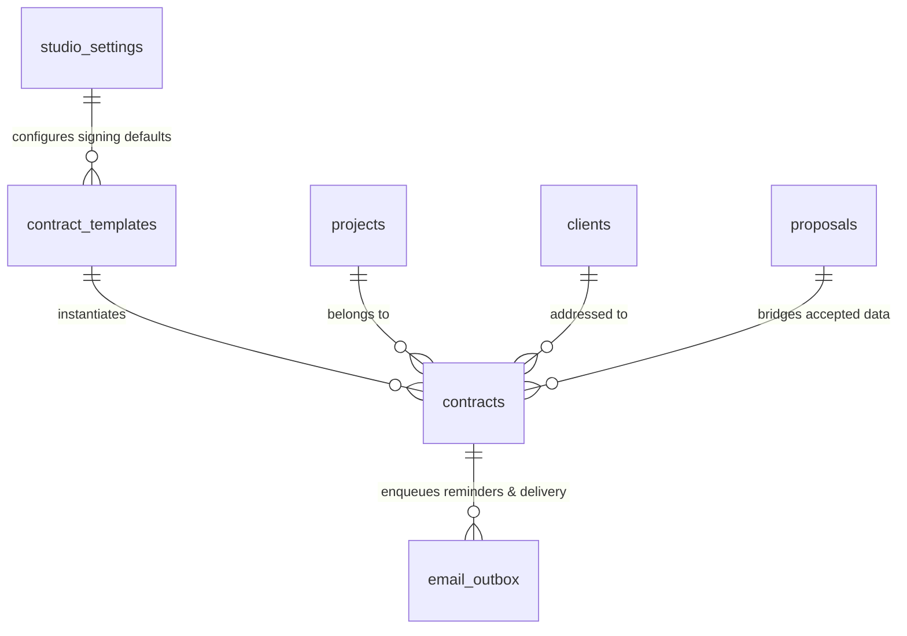
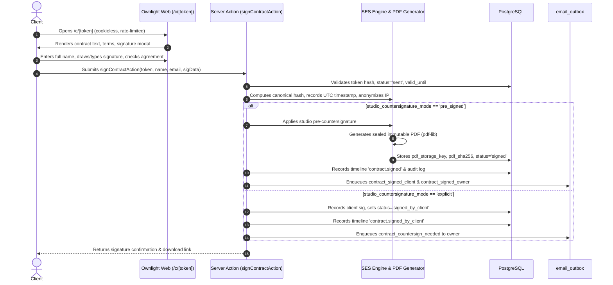

# ADR-0019: Contracts and e-signature with deterministic merge fields, pure-JS immutable PDF generation, and statutory commercial retention

- Status: Accepted (2026-11-06)
- Date: 2026-11-06
- Deciders: Maintainer, Architect
- Related ADRs:
  - ADR-0002: Tech stack (Next.js App Router, PostgreSQL, Drizzle ORM, Tailwind CSS, TypeScript)
  - ADR-0003: Self-hosted single studio architecture
  - ADR-0005: Internationalization (en/de catalogues, ICU message formatting)
  - ADR-0007: External accounting & tax platform connector (Lexware Office)
  - ADR-0010: Client search strategy (in-memory filtering, zero PII in query params or logs)
  - ADR-0011: Relationship history timeline as a dedicated, typed event table
  - ADR-0012: Data subject rights: export, erasure, and legal holds
  - ADR-0013: Retention runner and background worker loop
  - ADR-0015: Lead capture through public inquiry forms with atomic spam defence
  - ADR-0016: Projects and pipeline management (stages, shoots, lead conversion step)
  - ADR-0017: Studio calendar, availability engine, and public booking scheduler
  - ADR-0018: Packages, product catalogue, quotes, and interactive client proposals

---

## Context

Epic E6 ("Contracts with e-signature") introduces legally binding contractual agreements and electronic signatures to Ownlight. According to `projects/ownlight/docs/product/mvp-scope.md` (§E6) and `control/ownlight/roadmap.md`, the platform must provide:

1. **Contract templates with localized content:** Reusable contract templates (e.g., Wedding Photography Contract, Portrait Session Agreement, Commercial Model Release, Commercial Licensing Agreement) authored in English and German with categorized boilerplate clauses.
2. **Deterministic merge-field engine:** Safe token replacement replacing variables such as `{{client.name}}`, `{{project.title}}`, `{{shoot.date}}`, `{{package.name}}`, `{{studio.name}}`, and `{{contract.issue_date}}` with runtime commission data. The engine must strictly sanitize and HTML-escape interpolated values to prevent XSS and injection attacks, and permanently freeze the rendered text snapshot when a contract is issued or sent to a client.
3. **eIDAS Simple Electronic Signature (SES) & German Law Compliance:**
   - Under German civil law (BGB), photography and videography contracts are service or works contracts (_Dienstverträge_ § 611 BGB / _Werkverträge_ § 631 BGB). They do not require statutory notarisation or qualified electronic signatures (QES per § 126a BGB). Simple electronic form (_Textform_ per § 126b BGB) or contractually agreed electronic form (_Vereinbarte Form_ per § 127 Abs. 2 BGB) is legally valid, effective, and customary in the creative industry.
   - Under EU Regulation (EU) No 910/2014 (eIDAS) Art. 3(10), a Simple Electronic Signature (SES) consists of "data in electronic form which is attached to or logically associated with other data in electronic form and which is used by the signatory to sign". Per eIDAS Art. 25(1), an electronic signature shall not be denied legal effect and admissibility as evidence in legal proceedings solely because it is in electronic form or does not meet QES requirements.
   - To ensure maximum probative value (_Beweiskraft_) in court, the signature ceremony must create a tamper-evident evidence trail capturing: canonical text/HTML SHA-256 hash, final PDF SHA-256 hash, UTC timestamps, signer full name, verified email (delivered via private token link), signer IP address anonymised to subnet level (`/24` for IPv4, `/48` for IPv6 per GDPR data minimization), browser user-agent, and a dedicated audit certificate summary page appended to the signed PDF.
4. **Studio Countersignature Workflow:** Contracts require signatures from both the client and the studio owner. Solo photographers frequently prefer to pre-countersign standard agreements so the contract becomes immediately fully executed upon client signature, while other situations require explicit two-step countersigning (client signs first, studio owner reviews and countersigns). Studio settings must support both modes.
5. **Deterministic, Zero-Browser Pure-JS PDF Generation & Storage:**
   - Production deployments run on lightweight Alpine Linux containers (`node:24.2.0-alpine3.21`) with restricted CPU and memory (e.g. Synology NAS devices with 2–4 GB total system RAM). Running headless Chromium (Puppeteer/Playwright) in production would add 400+ MB of native browser binaries, require dozens of shared C-libraries and fonts, consume 200–500 MB RAM per rendering task, and introduce a substantial browser attack surface.
   - PDF generation must be executed 100% in pure JavaScript/TypeScript (e.g. `pdf-lib`) generating byte-for-byte deterministic, sealed PDFs within milliseconds without external process spawns.
   - Signed PDFs must be stored immutably in private storage (local filesystem volume / MinIO S3 object storage abstraction), referenced by random UUID storage keys, and cryptographically verified against their PostgreSQL SHA-256 hash on every read.
6. **Public Cookieless Signing Route & Reminders:** Frictionless client access via a revocable secret token URL (`/c/[token]` and `/[locale]/c/[token]`). The route must be cookieless (session cookies stripped per TDDDG §25 / GDPR Art. 5), rate-limited against brute-force attacks, and support automated and manual reminder emails via `email_outbox`.
7. **GDPR & Commercial Statutory Retention:**
   - GDPR Art. 15 DSAR export must include all contracts addressed to the data subject.
   - GDPR Art. 17 erasure: Draft or voided contracts (pre-contractual, never executed) must be hard-deleted upon client erasure.
   - Executed/signed contracts constitute commercial agreements and tax vouchers (_Handels- und Geschäftsbriefe, Buchungsbelege_) subject to statutory retention under §147 Abs. 1 Nr. 2 & 4 AO and §257 Abs. 1 Nr. 2 & 4 HGB. Under GDPR Art. 17(3)(b), statutory retention overrides erasure; signed contracts must enforce a 10-year legal hold preventing client erasure until the end of the statutory retention period.
8. **Bridge to Accepted Proposals (E5 → E6) & Project Timeline:**
   - Accepted proposals (`getAcceptedProposalForProject`) must automatically seed the contract builder with package name, included deliverables, selected add-ons, and monetary totals.
   - Contract lifecycle events (`contract.sent`, `contract.signed_by_client`, `contract.countersigned`, `contract.voided`) must integrate with the client relationship timeline and trigger optional project pipeline stage advancement (`booked`).

---

## Decision

### 1. Data Model & Database Schema

We define two relational tables in `src/server/db/schema/contracts.ts` and augment `studio_settings`:

#### 1.1 Studio Settings Augmentation (`studio_settings`)

We augment `studio_settings` (`src/server/db/schema/studio-settings.ts`) with signatory and studio contact details:

- `contract_signatory_name`: `varchar(200)` nullable — legal name of the photographer/signatory (e.g. "Jane Doe").
- `contract_signatory_title`: `varchar(100)` nullable — title/role (e.g. "Studio Owner", "Lead Photographer").
- `contract_countersignature_mode`: `varchar(32)` not null default `'pre_signed'` — enum: `'pre_signed'` (studio signature applied automatically when client signs), `'explicit'` (studio owner must manually countersign in dashboard after client signs).
- `studio_address_line1`: `varchar(200)` nullable — physical street address for legal notices.
- `studio_address_line2`: `varchar(200)` nullable.
- `studio_postal_code`: `varchar(20)` nullable.
- `studio_city`: `varchar(100)` nullable.
- `studio_country_code`: `char(2)` not null default `'DE'`.
- `studio_phone`: `varchar(50)` nullable.
- `studio_email`: `varchar(255)` nullable — primary business email for contractual notices.

#### 1.2 `contract_templates`

Represents reusable contract boilerplates authored by the studio:

- `id`: UUIDv7 PK.
- `name`: `varchar(150)` not null (e.g. "Standard Wedding Photography Agreement", "Portrait Session Terms").
- `slug`: `varchar(100)` unique not null.
- `description`: `text` nullable.
- `project_type_key`: `varchar(40)` nullable — optional association to project types (`'wedding'`, `'portrait'`, `'commercial'`, `'event'`, `'video'`) to auto-select the matching template in the contract composer.
- `content_en`: `text` not null — markdown/plain contract clauses in English with merge tags.
- `content_de`: `text` not null — markdown/plain contract clauses in German with merge tags.
- `is_default`: `boolean` not null default `false` — default template for its project type.
- `is_active`: `boolean` not null default `true` — soft deactivation so historical contracts remain verifiable.
- `created_at`, `updated_at`: `timestamptz` not null default `now()`.

_Indexes:_

- `contract_templates_slug_idx` on `(slug)`
- `contract_templates_project_type_key_idx` on `(project_type_key)`

#### 1.3 `contracts`

Core contract entity attached to a client project:

- `id`: UUIDv7 PK.
- `project_id`: UUID FK → `projects.id` not null (`onDelete: 'cascade'`).
- `client_id`: UUID FK → `clients.id` not null (`onDelete: 'restrict'`).
- `proposal_id`: UUID FK → `proposals.id` nullable (`onDelete: 'set null'`) — optional back-reference to the accepted proposal.
- `template_id`: UUID FK → `contract_templates.id` nullable (`onDelete: 'set null'`).
- `contract_number`: `varchar(50)` not null unique — human-readable sequential identifier (e.g. `CTR-2026-0001`).
- `title`: `varchar(200)` not null (e.g. "Wedding Photography Agreement — Liam & Emma").
- `locale`: `varchar(10)` not null default `'en'` — language of the contract (`'en'` or `'de'`).
- `status`: `varchar(32)` not null default `'draft'` — enum:
  - `'draft'`: Editable by photographer in project workspace.
  - `'sent'`: Delivered to client via secret signing link; awaiting client signature.
  - `'signed_by_client'`: Client completed SES ceremony; awaiting studio countersignature (in `'explicit'` mode).
  - `'signed'`: Fully executed by both client and studio; immutable PDF generated and sealed.
  - `'declined'`: Client rejected terms or requested amendments.
  - `'voided'`: Photographer cancelled contract before execution.
  - `'superseded'`: Replaced by a revised contract version.
- `rendered_body`: `text` not null — snapshotted contract text after merge field interpolation. Once status leaves `'draft'`, this field is immutable.
- `merge_values_snapshot`: `jsonb` not null — complete JSON dictionary of all evaluated merge variables at issuance time.
- `canonical_body_sha256`: `varchar(64)` not null — SHA-256 hash of normalized UTF-8 `rendered_body` for tamper verification.
- `valid_until`: `timestamptz` nullable — expiration date for signing link.
- `token_hash`: `varchar(64)` not null unique — SHA-256 hash of revocable public signing token.
- `token_revoked_at`: `timestamptz` nullable.
- `sent_at`: `timestamptz` nullable.
- `reminded_at`: `timestamptz` nullable — timestamp of last signing reminder sent.
- `reminder_count`: `integer` not null default 0.

_Client Signature Audit Trail:_

- `client_signed_at`: `timestamptz` nullable.
- `client_signer_name`: `varchar(200)` nullable — full legal name entered by client during signing.
- `client_signer_email`: `varchar(255)` nullable — email address confirmed during signing.
- `client_signature_type`: `varchar(20)` nullable — `'drawn'` (base64 PNG vector) or `'typed'` (cursive typography).
- `client_signature_data`: `text` nullable — base64 data URI of drawn signature glyph or typed text string.
- `client_ip_anonymized`: `varchar(64)` nullable — IPv4 `/24` or IPv6 `/48` subnet mask.
- `client_user_agent`: `varchar(255)` nullable — truncated browser user-agent.

_Studio Countersignature Audit Trail:_

- `studio_signed_at`: `timestamptz` nullable.
- `studio_signer_name`: `varchar(200)` nullable.
- `studio_signer_title`: `varchar(100)` nullable.
- `studio_signature_data`: `text` nullable — base64 data URI of studio signature or typed representation.

_Final Sealed PDF Storage & Verification:_

- `pdf_storage_key`: `varchar(255)` nullable — private object storage or filesystem path (e.g. `contracts/2026/CTR-2026-0001-sealed.pdf`).
- `pdf_sha256`: `varchar(64)` nullable — SHA-256 checksum of generated signed PDF.
- `pdf_byte_size`: `integer` nullable.
- `pdf_generated_at`: `timestamptz` nullable.

_Internal Notes & Tracking:_

- `internal_notes`: `text` nullable — private photographer notes.
- `created_at`, `updated_at`: `timestamptz` not null default `now()`.

_Indexes:_

- `contracts_project_id_idx` on `(project_id)`
- `contracts_client_id_idx` on `(client_id)`
- `contracts_proposal_id_idx` on `(proposal_id)`
- `contracts_token_hash_idx` on `(token_hash)`
- `contracts_status_idx` on `(status)`
- `contracts_contract_number_idx` on `(contract_number)`

---

### 2. Deterministic Merge-Field Engine & Snapshot Immutability

#### 2.1 Allowlisted Merge Fields

The merge-field engine (`src/server/contracts/merge-engine.ts`) strictly defines supported merge tokens grouped into six namespaces:

| Namespace      | Token                      | Source                                      | Example Value                          |
| -------------- | -------------------------- | ------------------------------------------- | -------------------------------------- |
| **`client`**   | `{{client.name}}`          | Client display name or primary contact name | Emma Watson                            |
|                | `{{client.company}}`       | Client company name (if company)            | Watson Media GmbH                      |
|                | `{{client.email}}`         | Primary contact email                       | emma@example.com                       |
|                | `{{client.phone}}`         | Primary contact phone                       | +49 30 1234567                         |
|                | `{{client.address}}`       | Postal address line 1 & 2                   | Friedrichstraße 42                     |
|                | `{{client.city}}`          | Postal city                                 | Berlin                                 |
|                | `{{client.postal_code}}`   | Postal code                                 | 10117                                  |
|                | `{{client.country}}`       | Country code / name                         | DE                                     |
| **`project`**  | `{{project.title}}`        | Project title                               | Emma & Liam Wedding                    |
|                | `{{project.type}}`         | Localized project type                      | Wedding / Hochzeit                     |
|                | `{{project.price}}`        | Formatted total price                       | €2.500,00                              |
|                | `{{project.currency}}`     | Currency code                               | EUR                                    |
|                | `{{project.notes}}`        | Sanitized project public notes              | Special wishes: golden hour shoot      |
| **`shoot`**    | `{{shoot.date}}`           | Primary shoot start date (localized)        | 15. August 2026                        |
|                | `{{shoot.time}}`           | Primary shoot start time + timezone         | 14:00 (Europe/Berlin)                  |
|                | `{{shoot.timezone}}`       | Timezone identifier                         | Europe/Berlin                          |
|                | `{{shoot.location}}`       | Primary shoot location name                 | Schlosspark Sanssouci                  |
|                | `{{shoot.address}}`        | Primary shoot location address              | Maulbeerallee, 14469 Potsdam           |
| **`package`**  | `{{package.name}}`         | Accepted proposal / package name            | Full Day Wedding Coverage              |
|                | `{{package.deliverables}}` | Bulleted list of included items             | • 8h coverage\n• 400 photos\n• Gallery |
|                | `{{package.total}}`        | Accepted proposal total amount              | €2.500,00                              |
|                | `{{package.subtotal}}`     | Subtotal amount before tax                  | €2.100,84                              |
|                | `{{package.tax}}`          | Total tax amount                            | €399,16                                |
|                | `{{package.addons}}`       | Selected optional add-on products           | • Second Photographer (1x): €400,00    |
| **`studio`**   | `{{studio.name}}`          | Studio business name                        | Lichtwerk Fotografie                   |
|                | `{{studio.owner_name}}`    | Studio signatory / owner name               | Jane Doe                               |
|                | `{{studio.email}}`         | Studio business email                       | hello@lichtwerk.example                |
|                | `{{studio.phone}}`         | Studio phone number                         | +49 30 9876543                         |
|                | `{{studio.address}}`       | Studio physical address                     | Torstraße 100, 10119 Berlin            |
|                | `{{studio.tax_number}}`    | Studio tax number (_Steuernummer_)          | 12/345/67890                           |
|                | `{{studio.vat_id}}`        | Studio VAT ID (_USt-IdNr._)                 | DE123456789                            |
| **`contract`** | `{{contract.number}}`      | Contract reference number                   | CTR-2026-0001                          |
|                | `{{contract.issue_date}}`  | Date contract was generated/sent            | 06.11.2026                             |
|                | `{{contract.valid_until}}` | Date contract signing link expires          | 20.11.2026                             |

#### 2.2 Security, Sanitization & Strict Token Parsing

1. **Strict Regex Token Matching:** The parser matches `\{\{([a-zA-Z_]+)\.([a-zA-Z_]+)\}\}` against the known allowlist. Unrecognized tokens are flagged in the composer preview or cleanly removed without crashing.
2. **HTML / Special Character Escaping:** Every dynamic string interpolated into the contract text is sanitized: `<` becomes `&lt;`, `>` becomes `&gt;`, `&` becomes `&amp;`, `"` becomes `&quot;`, and control characters are stripped. This neutralizes XSS injection attacks from malicious inquiry form inputs or client contact names.
3. **Snapshot Freezing:** When a contract is moved to `'sent'` (issued to the client):
   - All merge variables are evaluated and serialized into `contracts.merge_values_snapshot` (`jsonb`).
   - The final resolved text is saved in `contracts.rendered_body`.
   - The canonical SHA-256 hash is computed: `contracts.canonical_body_sha256 = sha256(normalize(rendered_body))`.
   - After issuance, `rendered_body` and `merge_values_snapshot` are permanently read-only. Subsequent changes to client names, package prices, or studio addresses will never alter the contract.

---

### 3. Pure-JS Deterministic PDF Generator (`pdf-lib`) & Storage Architecture

#### 3.1 Pure-JS Generation via `pdf-lib` (Zero Headless Browser)

To ensure the Alpine production container remains lightweight (<150 MB), fast, and secure:

- We use `pdf-lib` (pure JavaScript/TypeScript, zero native dependencies, zero external process spawns).
- **Page Layout & Typography:**
  - Uses standard embedded PostScript fonts (Helvetica / Helvetica-Bold / Courier) or bundled TrueType font subsets for German umlauts (`ä`, `ö`, `ü`, `ß`).
  - Implements clean, professional page layout: Header (Studio Name, Document Title, Contract Number, Page X of Y), Body (justified clause paragraphs, bulleted deliverables, pricing summary table), Signatures section (Studio + Client signature blocks with timestamp and legal text), and an integral **Certificate of Signature** final page.
- **Performance & Determinism:**
  - PDF generation completes in 20–40 ms on single-core CPU.
  - Generates byte-for-byte deterministic PDF binaries.
  - Zero risk of Chromium memory leaks, zombie processes, or font rendering discrepancies between local Mac/Windows dev environments and Alpine production containers.

#### 3.2 Certificate of Signature Page (Audit Trail)

The generated PDF concludes with an official **"Certificate of Signature & Audit Trail"** (_Signaturprotokoll_) containing:

1. **Document Integrity:** Canonical contract text SHA-256 hash, PDF creation timestamp (UTC).
2. **Client Signatory Block:** Full legal name, verified email, signature mode (`'drawn'` vector or `'typed'`), UTC timestamp, anonymised IP subnet (`/24` or `/48`), browser User-Agent summary.
3. **Studio Signatory Block:** Studio owner name, title, signature data, UTC timestamp.
4. **Legal Admissibility Clause:** Statement citing Regulation (EU) No 910/2014 (eIDAS) Art. 3(10) & Art. 25(1) and BGB § 126b / § 127(2).

#### 3.3 Storage Abstraction & Cryptographic Verification

1. **Storage Path:** Signed PDFs are saved to private storage under `contracts/[year]/[contract_number]-[uuid].pdf` (using the storage volume abstraction or MinIO S3 bucket `STORAGE_BUCKET_UPLOADS`).
2. **SHA-256 Seal:** At the moment of generation, the SHA-256 hash of the final PDF buffer is computed and written to `contracts.pdf_sha256`.
3. **Integrity Check on Read:** Whenever a signed PDF is downloaded or streamed (`/api/contracts/[id]/pdf` or `/c/[token]/pdf`), the service computes `sha256(retrieved_buffer)` and asserts it matches `contracts.pdf_sha256`. If the checksum differs, the service aborts with a `TamperedDocumentError` and logs a security alert.

---

### 4. eIDAS Simple Electronic Signature (SES) Ceremony & Tamper-Evident Evidence Trail

#### 4.1 Client Signing Ceremony

1. **Access:** Client receives signing link `https://studio.example/c/[token]`.
2. **Presentation:** Public, responsive contract viewer displaying studio branding, contract number, full snapshotted agreement clauses, deliverables, and financial terms.
3. **Execution Dialog:** When clicking _"Sign Contract"_, a modal prompts:
   - Full Legal Name (required, pre-filled from primary contact).
   - Email Address (required, pre-filled).
   - Signature Selection: Tab 1 "Draw Signature" (HTML5 canvas signature pad capturing PNG data URI) or Tab 2 "Type Signature" (renders legal name in stylized cursive typography).
   - Mandatory Checkbox: _"I have read, understood, and hereby agree to the terms of this contract. I acknowledge that clicking 'Sign & Accept' constitutes my legally binding simple electronic signature (eIDAS Art. 3(10) / BGB § 126b)."_
4. **Server-Side Validation & Anonymization:**
   - Evaluates token against `contracts.token_hash`.
   - Verifies `status === 'sent'` and `valid_until > now()`.
   - Anonymizes remote IP address using standard subnet masking (`192.0.2.123` → `192.0.2.0/24`, `2001:db8::1` → `2001:db8::/48`).
   - Captures truncated User-Agent.

#### 4.2 Studio Countersignature Modes

1. **Pre-Countersigned Mode (`'pre_signed'`, Studio Default):**
   - The studio owner configures their signature name, title, and default signature glyph in `/settings/contracts`.
   - When the client completes signing, the system immediately applies the studio's countersignature in the same transaction.
   - The contract transitions directly from `'sent'` → `'signed'`.
   - The sealed PDF is generated immediately and attached to client and owner confirmation emails.
2. **Explicit Countersignature Mode (`'explicit'`):**
   - When the client signs, status transitions to `'signed_by_client'`.
   - Studio owner receives an email notification alerting them that countersignature is required.
   - In the project workspace, the photographer reviews client signature details and clicks _"Countersign Contract"_.
   - Upon owner countersigning, status moves to `'signed'`, the final PDF is generated and sealed, and client is notified.

---

### 5. Public Cookieless Signing Route & Transactional Emails

#### 5.1 Route Security (`src/middleware.ts`)

- `/c` is added to `PUBLIC_PATH_SEGMENTS`.
- Helper `isPublicContractRoute(pathname)` detects `/c/[token]` and `/[locale]/c/[token]`.
- Enforces strict cookieless privacy: `response.headers.delete('set-cookie')` removes all session cookies.
- Protects against brute-force attacks via `rate-limiter.ts` (30 requests/minute per IP).
- Includes security headers: `X-Robots-Tag: noindex, nofollow`, `Cache-Control: no-store, max-age=0`.

#### 5.2 Transactional Email Outbox Notifications

We extend `src/server/db/schema/email-outbox.ts`:

- Add `contract_id`: UUID FK → `contracts.id` nullable (`onDelete: 'cascade'`).
- Extend `EMAIL_OUTBOX_KINDS` with:
  - `contract_sent`: Sent to client with signing link `/c/[token]`, expiration date, and studio details.
  - `contract_reminder`: Polite reminder sent manually or automatically prior to expiration.
  - `contract_signed_client`: Sent to client confirming full execution, with link to download sealed PDF.
  - `contract_signed_owner`: Alert to studio owner that contract is executed (or needs countersigning).

---

### 6. Downstream Subsystem Interfaces

#### 6.1 Proposal-to-Contract Bridge (`E5 → E6`)

Using `getAcceptedProposalForProject(projectId)` from `src/server/proposals/accepted-summary.ts`:

- Project workspace features a 1-click button: _"Create Contract from Accepted Proposal"_.
- Automatically resolves:
  - Base package name and bundled deliverables → `{{package.name}}`, `{{package.deliverables}}`.
  - Selected add-on products and quantities → `{{package.addons}}`.
  - Financial amounts → `{{package.subtotal}}`, `{{package.tax}}`, `{{package.total}}`.
  - Client contacts, addresses, and shoot dates.
- Photographer reviews and edits clauses in the contract composer, then clicks _"Send Contract"_.

#### 6.2 Relationship Timeline & Pipeline Stage Sync

- Timeline events registered in `src/server/timeline/registry.ts`:
  - `contract.sent` (`dataKeys: ['contract_id', 'contract_number']`)
  - `contract.signed_by_client` (`dataKeys: ['contract_id', 'contract_number', 'signer_name']`)
  - `contract.countersigned` (`dataKeys: ['contract_id', 'contract_number']`)
  - `contract.voided` (`dataKeys: ['contract_id', 'contract_number']`)
- Pipeline Stage Hook: When a contract becomes fully `'signed'`:
  - If project is currently in stage `'inquiry'` or `'booked'`, the system verifies if stage advancement or checklist task completion is configured.

#### 6.3 Interface to E9 (Client Portal) & E12 (Lexware Connector)

- **E9 Client Portal:** The token route `/c/[token]` seamlessly integrates into the future project portal hub (`/portal/[token]/contract`).
- **E12 Lexware Office Connector:** Contract execution provides the final binding trigger for automated Lexware down-payment invoice generation (_Anzahlungsrechnung_).

---

### 7. Privacy, Security & Statutory Retention Compliance

#### 7.1 GDPR Art. 15 DSAR Export Provider

Registered via `registerExportProvider` in `src/server/privacy/export-registry.ts`:

- Subject kinds: `client`, `contact`.
- JSON category: `contracts` (`ownlight.dsar.v1`).
- HTML export: Localized, accessible table (en/de) listing Contract Number, Title, Status, Issued Date, Signed Date, Signatory Name, and Verification Hash.

#### 7.2 GDPR Art. 17 Erasure Provider

Registered via `registerErasureProvider` in `src/server/privacy/erasure-registry.ts`:

- Draft, declined, or voided contracts represent non-binding negotiations.
- When client erasure is processed, `contractsErasureProvider` hard-deletes unexecuted contracts and removes any ephemeral draft files.

#### 7.3 Statutory Commercial Retention Lock Provider (§147 AO / §257 HGB)

Registered via `registerErasureHoldProvider` in `src/server/privacy/erasure-registry.ts`:

- Under German commercial and tax law (§147 Abs. 1 Nr. 2 & 4 AO, §257 Abs. 1 Nr. 2 & 4 HGB), executed commercial contracts, works contracts (_Werkverträge_), and associated booking documents must be preserved for **10 years** starting from the end of the calendar year in which the contract was executed.
- `contractsHoldProvider` checks for any contract with `status === 'signed'`.
- If an executed contract exists, client erasure is blocked with hold code `statutory.commercial_contract` and retention lock date calculated as:
  $$\text{Lock Date} = \text{UTC}(\text{Year}(\text{signed\_at}) + 10, 11, 31, 23:59:59.999)$$
- Strictly complies with GDPR Art. 17(3)(b) (statutory retention exception).

#### 7.4 Audit Allowlist Registrations (`src/server/audit/allowlist.ts`)

- `contract_template.created`, `contract_template.updated`, `contract_template.deleted`
- `contract.created`, `contract.updated`, `contract.sent`, `contract.signed_by_client`, `contract.countersigned`, `contract.voided`, `contract.revoked`, `contract.reminded`
- `studio_settings.contract_updated`

---

## Alternatives Considered

1. **Headless Browser (Puppeteer / Chromium / Playwright) for PDF Generation:**
   - _Considered:_ Rendering contracts via headless Chrome to convert HTML/CSS into PDF.
   - _Rejected:_ Adds 400+ MB of native browser binaries and libraries to the production container; consumes hundreds of MB RAM per render (risking OOM on 2 GB Synology NAS appliances); creates severe cold-start latency; opens major security vulnerabilities from headless browser sandboxing.
2. **Third-Party E-Signature SaaS (DocuSign / Adobe Sign / HelloSign):**
   - _Considered:_ Offloading signature collection to an external cloud e-signature API.
   - _Rejected:_ Violates core product principles (self-hosted, privacy-first, zero third-party data leaks, no monthly recurring API costs). Transmits sensitive client contracts and personal data to US cloud processors, triggering GDPR Schrems II transfer issues.
3. **Qualified Electronic Signatures (QES) with Hardware Token / ID-Card Verification:**
   - _Considered:_ Requiring German eID / eIDAS QES signatures for all photography contracts.
   - _Rejected:_ Grossly disproportionate friction for wedding and portrait clients. German law (§ 126b, § 127(2) BGB) explicitly permits simple electronic form for service agreements. QES would result in 90%+ abandonment by everyday consumers.
4. **Dynamic Contract Text Rendering on Demand Without Snapshotting:**
   - _Considered:_ Merging fields dynamically whenever a contract is viewed instead of storing `rendered_body`.
   - _Rejected:_ Fatal legal defect. If a photographer subsequently edits their studio address, or changes a package description, the contract text would retroactively mutate, destroying legal integrity and evidentiary validity.

---

## Consequences

- Photographers can create, customize, and manage reusable bilingual contract templates.
- Contracts can be issued in 1 click from accepted proposals with guaranteed mathematical and textual fidelity.
- Clients enjoy a seamless, mobile-friendly signing experience with zero login hurdles.
- Signed PDFs are generated in milliseconds in pure JavaScript, cryptographically sealed, and verifiable against tampering.
- Compliance with German civil law (BGB), commercial law (HGB, AO), EU eIDAS, and GDPR is built into the architecture.

---

## Security & Privacy Impact

- **OWASP ASVS 5.0 L2 Alignment:**
  - V2 (Authentication): Public signing tokens are 256-bit cryptographically secure random strings hashed with SHA-256 in the database; links can be revoked instantly.
  - V3 (Validation): Strict token allowlisting and HTML sanitization prevent stored XSS and injection attacks via contract text.
  - V5 (File Storage): Signed PDFs are stored with unguessable keys in private storage, never exposed publicly, and cryptographically verified against SHA-256 on retrieval.
  - V16 (Logging): IP addresses are masked to subnet level (`/24` or `/48`) before storage; raw tokens and PII are never logged.
- **GDPR Art. 25 (Privacy by Design):** Cookieless signing routes prevent cross-site tracking; public URLs include `X-Robots-Tag: noindex, nofollow` to prevent search engine indexing.
